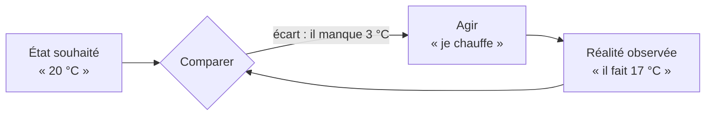

Un pod lancé à la main puis supprimé ne revient pas ; le pod d'un Deployment, lui, est remplacé en quelques secondes. La différence ne tient pas à la commande, mais à ce que vous avez donné à Kubernetes : un **ordre** dans un cas, un **objectif** dans l'autre. Cette page met des mots sur cette idée, l'**état souhaité**, et montre qu'elle dépasse Kubernetes : vous la reconnaîtrez dans d'autres outils.

**Prérequis** : avoir vu un orchestrateur recréer ce qu'on lui supprime. Dans le parcours Kubernetes, c'est ce que fait faire [Déployer une application avec un Deployment](https://byte-layers.com/fr/skills/k8s-deployment) : cette page se lit après ce cours, et explique ce que vous y avez observé.

# L'état souhaité : un objectif, pas un ordre

## Un ordre ou un objectif : le radiateur et le thermostat

Il y a deux façons de chauffer une pièce.

| | Un ordre | Un objectif |
|---|---|---|
| Ce que vous dites | « Allume le radiateur. » | « Je veux 20 °C. » |
| Ce qui se passe | il chauffe… puis plus personne ne surveille. Une fenêtre ouverte ? Tant pis | le thermostat mesure en permanence et ajuste tout seul |
| Le mot qu'on emploie | **impératif** : on dit quoi faire | **déclaratif** : on dit ce qu'on veut obtenir |
| Avec Kubernetes | `kubectl run` : « lance ce pod » | un Deployment : « je veux en permanence 1 exemplaire de `vote` » |

L'objectif que vous déclarez s'appelle l'**état souhaité** (*desired state*). Avec un ordre, c'est vous qui surveillez et qui recommencez quand quelque chose casse. Avec un état souhaité, c'est le système. **Kubernetes est un thermostat pour applications.**

## La boucle de réconciliation : observer, comparer, agir

Un thermostat ne chauffe pas « une fois ». Il répète sans fin les trois mêmes gestes, que ce schéma met en boucle : il observe la réalité, la compare à l'état souhaité, et agit s'il y a un écart.



Kubernetes fait exactement la même chose avec vos pods, et cette boucle porte un nom : la **boucle de réconciliation**. Les programmes qui la font tourner s'appellent des **contrôleurs**.

Le tableau met les deux boucles côte à côte.

| | Le thermostat | Kubernetes |
|---|---|---|
| État souhaité | « 20 °C » | « 1 exemplaire de `vote` » |
| Réalité observée | « il fait 17 °C » | « je vois 0 pod » |
| Action | il chauffe | il crée 1 pod |
| Ensuite | il recommence, en permanence | il recommence, en permanence |

Ce changement de point de vue explique ce que vous avez vu. Une panne, une erreur de manipulation ou un serveur qui redémarre ne sont plus des événements à traiter un par un : ce ne sont que des **écarts** entre la réalité et l'état souhaité, et la boucle les corrige tous de la même façon.

## Dans Kubernetes : un fichier qui décrit, spec et status

Un script dit **comment** faire : « télécharge l'image, lance le conteneur, ouvre le port ». Le fichier d'un Deployment ne contient aucun verbe. Il dit seulement **ce qui doit être vrai** :

```yaml
spec:
  replicas: 1                                 # je veux 1 exemplaire
  template:
    spec:
      containers:
        - image: ghcr.io/bngams/kube-vote:1.0 # de cette image
```

Kubernetes garde cette description, et range à côté ce qu'il observe. Dans un objet Kubernetes, la partie `spec` est l'état souhaité, que vous écrivez, et la partie `status` est la réalité, que Kubernetes remplit. Voici un extrait de ce que répond `kubectl get deployment vote -o yaml`, qui affiche le Deployment `vote` en entier :

```yaml
spec:
  replicas: 1          # ce que vous avez demandé
status:
  readyReplicas: 1     # ce que Kubernetes observe : 1 pod prêt
  replicas: 1
```

Tout le travail de la boucle consiste à faire en sorte que `status` rejoigne `spec`. Et pour changer quelque chose, vous ne donnez pas un nouvel ordre : vous **modifiez la description**, et la boucle fait le chemin.

## La même idée, hors de Kubernetes

L'idée n'appartient pas à Kubernetes. Deux questions permettent de la reconnaître dans un outil : décrit-on un résultat plutôt que des gestes, et quelqu'un surveille-t-il **en continu** ?

| Exemple | On décrit le résultat ? | Qui compare, et quand ? |
|---|---|---|
| Un thermostat | oui : une température | le thermostat, en continu |
| Le régulateur de vitesse d'une voiture | oui : une vitesse | le régulateur, en continu |
| Un fichier Docker Compose, qui décrit les conteneurs d'une application sur une machine | oui : des services, leurs images, leurs ports | `docker compose up`, **quand vous le lancez** |
| Un orchestrateur comme Kubernetes | oui : des objets, comme un Deployment | ses contrôleurs, en continu |

La dernière colonne fait toute la différence. Un fichier Compose est bien une description, et `docker compose up` compare bien ce qui tourne à ce que vous décrivez. Mais une fois la comparaison faite, plus personne ne la refait : un conteneur supprimé ensuite n'est pas recréé. Un orchestrateur ajoute la boucle : la description reste, et la surveillance ne s'arrête pas.

> 💡 **Ce que la boucle ne fait pas.** Elle ramène la réalité vers la description, rien de plus. Si la description est fausse, par exemple une image qui n'existe pas, la boucle essaie sans fin sans jamais y arriver : c'est à vous de corriger la description.

> 📖 [Les contrôleurs, et leur thermostat](https://kubernetes.io/fr/docs/concepts/architecture/controller/) · [Les objets Kubernetes : `spec` et `status`](https://kubernetes.io/docs/concepts/overview/working-with-objects/) · [Les Deployments](https://kubernetes.io/fr/docs/concepts/workloads/controllers/deployment/)

## Ce qu'il faut retenir

- Un **ordre** (impératif) s'exécute une fois, puis plus personne ne surveille. Un **objectif** (déclaratif) est tenu dans la durée.
- L'objectif s'appelle l'**état souhaité**. Dans Kubernetes, il s'écrit dans la partie `spec` d'un fichier YAML.
- La **boucle de réconciliation** observe, compare et agit, en permanence : une panne n'est qu'un écart à corriger.
- Pour changer le système, on change la description.

```quiz
prompt: "Votre Deployment demande 3 exemplaires d'une application. Un serveur tombe en panne et emporte l'un des pods. Que fait Kubernetes ?"
answers:
  - "Rien : il a déjà exécuté l'ordre de lancer 3 pods"
  - "Il constate qu'il n'en voit plus que 2 pour 3 souhaités, et en crée 1"
  - "Il attend qu'on applique de nouveau le fichier"
correct: 2
explanation: |
  Il n'a pas reçu un ordre, mais un état souhaité. Sa boucle de réconciliation compare en permanence cet état à ce qu'elle observe, et corrige l'écart sans qu'on le lui demande.
```

```ack
J'ai compris
```
