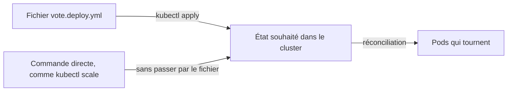

Un collègue passe une application de 3 à 5 exemplaires avec une commande, un soir de forte affluence. Le lendemain, quelqu'un applique le fichier de l'application pour une toute autre raison, et les deux exemplaires en plus disparaissent sans un message. Personne n'a fait d'erreur de frappe : il y avait simplement deux endroits qui disaient combien d'exemplaires on voulait, et un seul des deux fait foi. Vous saurez lequel, pourquoi, et où ranger ce fichier pour qu'il reste la référence.

**Prérequis** : savoir changer le nombre de réplicas d'un Deployment avec son fichier et avec `kubectl scale`, ce qu'enseigne [Passer à l'échelle avec les réplicas](https://byte-layers.com/fr/skills/k8s-scaling). Les commandes de cette page se servent du Deployment `vote` et du fichier `~/byte-layers/kubernetes/l2/vote.deploy.yml` que ce cours laisse en place. Si la première commande répond `not found`, le Deployment n'y est plus : refaites d'abord ce cours.

# Le fichier fait foi

## Deux endroits disent combien de pods vous voulez

L'**état souhaité** d'une application, par exemple « 3 exemplaires de `vote` », existe à deux endroits. Il est écrit dans votre **fichier** YAML, et il est enregistré dans le **cluster**, qui le compare en permanence à ce qui tourne. `kubectl apply` recopie le premier dans le second. Ce schéma montre les deux chemins par lesquels le cluster peut changer :



Le chemin du haut laisse une trace : le fichier. Celui du bas n'en laisse aucune. Tant que vous ne prenez que le premier, le fichier et le cluster disent la même chose.

## Un changement fait à la main n'existe que dans le cluster

Prenez le second chemin, pour voir. `vote` tourne avec 3 réplicas ; demandez-en 2 avec `kubectl scale`, sans toucher au fichier :

```exec
kubectl scale deployment vote --replicas=2
```

Demandez ensuite au cluster ce qu'il a retenu :

```exec
kubectl get deployment vote
```

Le cluster a obéi : il ne demande plus que 2 pods. Si vous lisez encore `3/2`, le troisième pod est en train de s'arrêter : relancez la commande.

```text
NAME   READY   UP-TO-DATE   AVAILABLE   AGE
vote   2/2     2            2           12m
```

Regardez maintenant ce que dit le fichier. `grep` affiche les lignes d'un fichier qui contiennent un mot, ici `replicas` :

```exec
grep replicas ~/byte-layers/kubernetes/l2/vote.deploy.yml
```

Le fichier, lui, n'a pas changé : il demande toujours 3 réplicas.

```text
  replicas: 3
```

Les deux endroits ne disent plus la même chose. On appelle cela un **écart** (*drift*, une dérive) : le cluster s'est éloigné de ce qui est écrit. Rien ne le signale, et quelqu'un qui lit le fichier croit que 3 pods tournent.

## Le prochain apply rétablit ce que dit le fichier

Appliquez le fichier, comme le ferait n'importe qui dans l'équipe. Avant de lancer, faites une prévision : `kubectl apply` va-t-il répondre `unchanged`, puisque le fichier n'a pas été modifié ?

```exec
kubectl apply -f ~/byte-layers/kubernetes/l2/vote.deploy.yml
```

Il répond `configured` : `kubectl apply` ne regarde pas si le fichier a changé, il compare le fichier au cluster, et il a trouvé une différence.

```text
deployment.apps/vote configured
```

Attendez que le troisième pod soit prêt, puis regardez le Deployment :

```exec
kubectl rollout status deployment/vote --timeout=120s
kubectl get deployment vote
```

Le cluster est revenu à ce que dit le fichier, et votre changement à la main a disparu.

```text
deployment "vote" successfully rolled out
NAME   READY   UP-TO-DATE   AVAILABLE   AGE
vote   3/3     3            3           13m
```

C'est le sens de « le fichier fait foi » : quand le fichier et le cluster ne sont pas d'accord, c'est le fichier qui gagne, au prochain `apply`. Un changement qui doit durer s'écrit donc **dans le fichier**, puis s'applique.

> 💡 **Remarque.** `kubectl apply` ne rétablit que ce que le fichier écrit. Un réglage ajouté à la main et dont le fichier ne parle pas, une étiquette en plus par exemple, peut rester dans le cluster sans que rien ne le décrive nulle part. C'est une raison de plus de ne rien changer à la main.

## Ranger les fichiers dans Git

Si le fichier fait foi, il devient aussi important que l'application elle-même : le perdre, c'est ne plus savoir ce qu'on a demandé. En entreprise, les fichiers YAML sont donc rangés dans un outil de gestion de versions, **Git** le plus souvent. On y gagne trois choses :

| Question | Ce que Git répond |
|---|---|
| Qui a changé le nombre de réplicas, quand et pourquoi ? | chaque modification est enregistrée avec son auteur, sa date et un message |
| Que demandait-on la semaine dernière ? | chaque état passé du fichier peut être relu |
| Comment annuler un changement qui a mal tourné ? | on revient à l'état précédent du fichier, puis on l'applique |

Git devient alors la **source** de ce qui tourne : pour savoir ce que le cluster doit faire, on lit le dépôt, pas le cluster. Certaines équipes vont jusqu'à interdire les modifications directes : un outil applique automatiquement ce qui est dans Git. Ce principe s'appelle le **GitOps**, et il se résume à « le fichier fait foi », poussé jusqu'au bout.

Si vous ne connaissez pas encore Git, [Pourquoi versionner son travail](https://byte-layers.com/fr/bits/why-version-control) en donne l'idée en dix minutes.

> ⚖️ `kubectl scale` reste utile en urgence, par exemple pour absorber un pic de visiteurs. Mais il faut **reporter ensuite la valeur dans le fichier**, sinon elle sera perdue au prochain `apply`.

> 📖 [Les façons de gérer ses objets Kubernetes](https://kubernetes.io/docs/concepts/overview/working-with-objects/object-management/) · [Gérer ses objets avec des fichiers de configuration](https://kubernetes.io/docs/tasks/manage-kubernetes-objects/declarative-config/) · [`kubectl apply`](https://kubernetes.io/docs/reference/kubectl/generated/kubectl_apply/)

## Récap

- L'état souhaité existe à deux endroits : dans le fichier, et dans le cluster. `kubectl apply` recopie le premier dans le second.
- Une commande directe comme `kubectl scale` ne change que le cluster : le prochain `apply` l'efface.
- Un changement qui doit durer s'écrit dans le fichier.
- Rangé dans Git, le fichier dit qui a changé quoi, quand et pourquoi, et permet de revenir en arrière.

```quiz
prompt: "Le fichier d'un Deployment dit `replicas: 3`. En urgence, vous passez à 6 avec `kubectl scale`, et tout va bien. Que faut-il faire ensuite ?"
answers:
  - "Rien : le cluster a retenu 6"
  - "Écrire 6 dans le fichier, sinon le prochain `kubectl apply` reviendra à 3"
  - "Supprimer le Deployment et le recréer"
correct: 2
explanation: |
  Le cluster a bien retenu 6, mais le fichier dit toujours 3, et c'est lui qui fait foi : le prochain `apply` annulerait votre changement, sans prévenir.
```

```ack
J'ai compris
```
