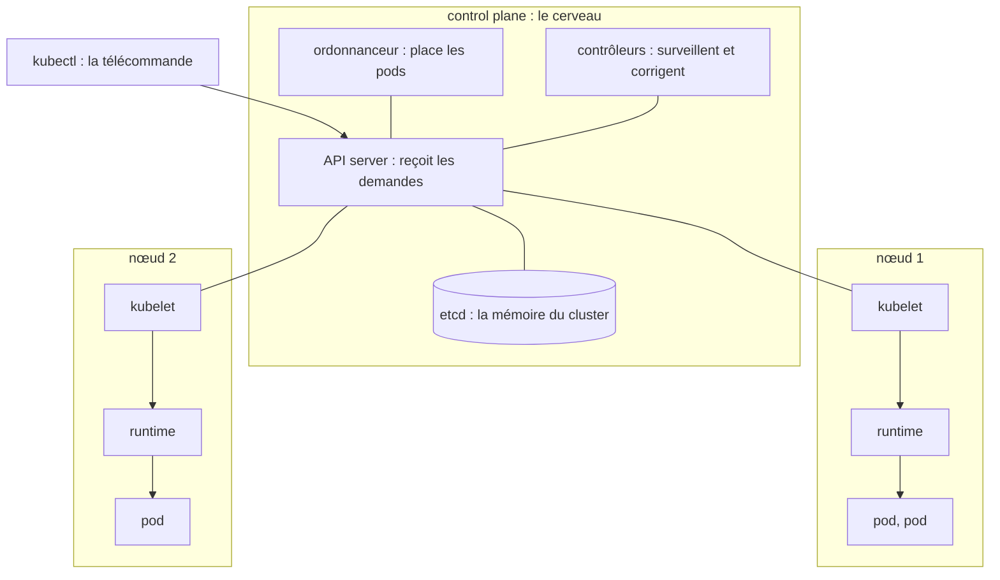

Quand vous tapez `kubectl get nodes`, quelqu'un répond. Quand vous demandez un pod, quelqu'un choisit où le lancer, et quelqu'un d'autre le lance. Un cluster Kubernetes est fait de quelques composants qui se partagent ce travail : vous saurez nommer chacun, dire ce qu'il fait, et vous les aurez vus tourner dans votre propre cluster.

**Prérequis** : un cluster qui répond à `kubectl get nodes` et y avoir lancé un pod, ce que fait le lab [Démarrer son cluster Kubernetes](https://byte-layers.com/fr/labs/k8s-install).

# Ce qu'il y a dans un cluster Kubernetes

## Le control plane décide, les nœuds exécutent

Un cluster a deux parties. Le **control plane** en est le cerveau : il reçoit les demandes, s'en souvient et décide. Les **nœuds** (*nodes*) sont les serveurs qui font tourner les applications, dans des **pods**. Un pod enveloppe un conteneur, parfois plusieurs : c'est la plus petite unité lancée par Kubernetes. Ce schéma montre qui parle à qui, depuis votre terminal jusqu'aux pods.



Chaque boîte a un seul rôle :

| Élément | Rôle |
|---|---|
| `kubectl` | la télécommande : l'outil en ligne de commande qui parle au cluster. Il ne parle qu'à l'API server |
| **API server** | la porte unique du cluster : il reçoit toutes les demandes, les vôtres comme celles des autres composants |
| **etcd** | la mémoire du cluster : une base de données où est noté tout ce qu'on a demandé et tout ce qui existe |
| **Ordonnanceur** (*scheduler*) | il choisit sur quel nœud placer chaque nouveau pod |
| **Contrôleurs** (*controller manager*) | ils comparent en permanence ce qui est demandé à ce qui existe, et corrigent l'écart |
| **kubelet** | l'agent présent sur chaque nœud : il reçoit la liste des pods de son nœud et veille à ce qu'ils tournent |
| **Runtime** | le programme qui crée réellement les conteneurs, containerd le plus souvent. Le kubelet lui délègue ce travail |

Retenez la répartition : **Kubernetes décide quoi lancer et où, le runtime sait comment le lancer.**

## Un seul nœud, qui fait tout, dans votre cluster

Votre cluster d'apprentissage est un Kubernetes en miniature. Avant de lancer la commande, faites une prévision : combien de nœuds a-t-il, et où tourne son control plane ? L'option `-o wide` ajoute des colonnes à la réponse :

```exec
kubectl get nodes -o wide
```

Il n'y a qu'une ligne. Voici la réponse sur un poste, avec minikube :

```text
NAME         STATUS   ROLES           AGE     VERSION   INTERNAL-IP    EXTERNAL-IP   OS-IMAGE             KERNEL-VERSION     CONTAINER-RUNTIME
layers-k8s   Ready    control-plane   5m41s   v1.34.0   192.168.49.2   <none>        Ubuntu 22.04.5 LTS   6.10.14-linuxkit   docker://28.4.0
```

Deux colonnes répondent à la question. `ROLES` indique `control-plane` : ce nœud unique héberge le cerveau du cluster, et comme il n'y en a pas d'autre, il fait aussi tourner vos pods. `CONTAINER-RUNTIME` nomme le runtime : avec minikube, c'est Docker ; sur un poste hébergé, avec k3d, vous lisez `containerd`. Dans un cluster de production, les rôles sont séparés : quelques nœuds pour le control plane, et d'autres, souvent bien plus nombreux, pour les applications.

## Les composants du cluster tournent eux-mêmes dans des pods

Le lab vous a montré le namespace `kube-system`, celui du cluster lui-même. C'est là que vivent ses composants. L'option `-n` désigne le namespace à regarder, à la place du vôtre :

```exec
kubectl get pods -n kube-system
```

Voici la réponse sur un poste, avec minikube :

```text
NAME                                       READY   STATUS    RESTARTS        AGE
calico-kube-controllers-59556d9b4c-lvbrt   1/1     Running   1 (5m19s ago)   5m33s
calico-node-njv64                          1/1     Running   0               5m33s
coredns-66bc5c9577-g9jjn                   1/1     Running   1 (5m19s ago)   5m33s
etcd-layers-k8s                            1/1     Running   0               5m40s
kube-apiserver-layers-k8s                  1/1     Running   0               5m40s
kube-controller-manager-layers-k8s         1/1     Running   0               5m40s
kube-proxy-pj58p                           1/1     Running   0               5m33s
kube-scheduler-layers-k8s                  1/1     Running   0               5m40s
storage-provisioner                        1/1     Running   1 (5m2s ago)    5m37s
```

Vous y retrouvez le schéma, pièce par pièce :

| Pod | Ce que c'est |
|---|---|
| `kube-apiserver-layers-k8s` | l'API server |
| `etcd-layers-k8s` | etcd, la mémoire du cluster |
| `kube-scheduler-layers-k8s` | l'ordonnanceur |
| `kube-controller-manager-layers-k8s` | les contrôleurs |
| `calico-node-…`, `calico-kube-controllers-…`, `kube-proxy-…` | le réseau du cluster : ce qui permet aux pods de se parler |
| `coredns-…` | l'annuaire du cluster, qui traduit des noms en adresses |
| `storage-provisioner` | un utilitaire de minikube pour le stockage |

Les quatre premiers du tableau portent le nom du nœud, `layers-k8s`, parce qu'ils lui sont attachés. Kubernetes fait donc tourner ses propres composants comme il fera tourner vos applications : dans des pods.

Un seul manque à l'appel, le **kubelet**. Ce n'est pas un pod : c'est un programme installé directement sur le nœud, et pour cause, c'est lui qui lance les pods.

> 💡 **Sur un poste hébergé**, la liste est plus courte. k3d s'appuie sur k3s, un Kubernetes allégé qui réunit l'API server, l'ordonnanceur et les contrôleurs dans un seul programme : vous ne voyez donc pas leurs pods, seulement ceux de l'annuaire, du réseau et de quelques utilitaires. Les rôles, eux, sont les mêmes.

## Le trajet d'une demande, de kubectl au conteneur

Dans le lab, vous avez lancé un pod avec `kubectl run`. Vous pouvez maintenant dire ce qui s'est passé à ce moment-là, dans l'ordre :

1. `kubectl` a envoyé votre demande à l'**API server**.
2. L'API server l'a notée dans **etcd** : un pod est demandé, il n'existe pas encore.
3. L'**ordonnanceur** a vu ce pod sans nœud, et lui en a choisi un. Dans votre cluster, le choix est vite fait.
4. Le **kubelet** de ce nœud a vu qu'un pod lui était confié, et a demandé au **runtime** de télécharger l'image et de lancer le conteneur.
5. Le kubelet a rapporté l'état du pod à l'API server : c'est ce que `kubectl get pods` vous a affiché, `Running`.

L'ordonnanceur, les contrôleurs et les kubelets ne se parlent pas entre eux : tous passent par l'API server, comme vous. Lui seul lit et écrit dans etcd.

## Une métaphore : la ville

Pour garder ces mots en tête, pensez à une ville :

| Kubernetes | Dans la ville |
|---|---|
| Cluster | la ville |
| Nœud | un bâtiment |
| Pod | un appartement |
| Conteneur | un occupant |
| Namespace | un quartier |

La ville s'agrandira au fil du parcours : chaque nouvel objet de Kubernetes y trouvera sa place.

> 💡 **Dans un Kubernetes managé**, celui que louent les fournisseurs de cloud (EKS chez AWS, GKE chez Google, AKS chez Azure), le fournisseur gère le control plane à votre place : vous ne vous occupez que des nœuds et de vos applications.

> 📖 [Les composants de Kubernetes](https://kubernetes.io/fr/docs/concepts/overview/components/) · [L'architecture d'un cluster](https://kubernetes.io/docs/concepts/architecture/) · [Les nœuds](https://kubernetes.io/docs/concepts/architecture/nodes/) · [L'interface avec le runtime (CRI)](https://kubernetes.io/docs/concepts/architecture/cri/)

## Ce qu'il faut retenir

- Le control plane décide : l'API server reçoit les demandes, etcd s'en souvient, l'ordonnanceur place les pods, les contrôleurs corrigent les écarts.
- Les nœuds exécutent : sur chacun, le kubelet veille sur les pods et délègue leur lancement au runtime.
- Tout passe par l'API server, `kubectl` compris.
- Votre cluster d'apprentissage n'a qu'un nœud, qui fait tout.

```quiz
prompt: "Vous demandez un nouveau pod. Quel composant choisit le nœud sur lequel il tournera ?"
answers:
  - "Le kubelet, parce qu'il est présent sur chaque nœud"
  - "L'ordonnanceur (scheduler), qui fait partie du control plane"
  - "etcd, parce qu'il connaît tout le cluster"
correct: 2
explanation: |
  L'ordonnanceur choisit le nœud. Le kubelet de ce nœud lance ensuite le pod, et etcd ne fait que garder la mémoire de ce qui est demandé et de ce qui existe.
```

```ack
J'ai compris
```
