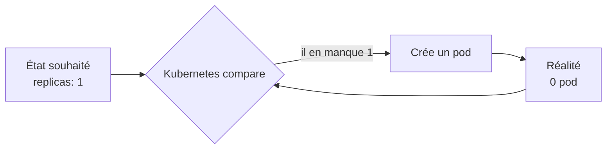

Vous allez simuler une panne en supprimant le pod, comme vous l'avez fait pour `vote-solo`. La différence, c'est qu'il y a cette fois un Deployment qui surveille.

## Noter le nom du pod et enregistrer ce qui se passe

Rouvrez d'abord le tunnel vers l'application, avec la même commande qu'à l'étape précédente : la panne le concerne aussi.

```exec
kubectl port-forward deployment/vote 28610:80 > /dev/null 2>&1 &
```

Notez ensuite le nom du pod actuel dans un fichier, pour le comparer à celui d'après. `-o name` demande à `kubectl get` de n'afficher que les noms, et `>` envoie cette réponse dans le fichier, comme pour `vote.deploy.yml` :

```exec
kubectl get pods -o name > ~/byte-layers/kubernetes/l1/pod-before.txt
```

Relisez ce fichier avec `cat` :

```exec
cat ~/byte-layers/kubernetes/l1/pod-before.txt
```

Il contient le nom de votre pod, précédé de son type :

```text
pod/vote-644d47956b-sz9mc
```

Pour **voir** la panne se dérouler, il reste à lancer une surveillance des pods. L'option `--watch` garde `kubectl get pods` ouverte et lui fait écrire une nouvelle ligne à **chaque changement**. Comme le tunnel, cette commande ne rend pas la main : vous la lancez donc de la même façon, en arrière-plan avec `&`, en envoyant cette fois ce qu'elle écrit dans le fichier `watch.txt`, que vous lirez après la panne.

```exec
kubectl get pods --watch > ~/byte-layers/kubernetes/l1/watch.txt 2>&1 &
```

## Supprimer le pod du Deployment

Avant de supprimer le pod, faites une prévision : combien de pods `kubectl get pods` montrera-t-il ensuite, et sous quel nom ?

À vous de supprimer le pod, avec `kubectl delete pod` suivi de **son nom** : celui de votre fichier, sans le `pod/` du début. Sélectionnez-le à la souris dans le terminal pour le copier. La commande peut mettre quelques secondes à rendre la main, puis répond `pod "…" deleted from default namespace`.

Laissez passer cinq secondes, puis arrêtez la surveillance :

```exec
pkill -f "get pods --watch"
```

Lisez ce qu'elle a enregistré :

```exec
cat ~/byte-layers/kubernetes/l1/watch.txt
```

Vous devez y lire une suite de lignes proche de celle-ci, où certaines lignes peuvent apparaître deux fois :

```text
NAME                    READY   STATUS              RESTARTS   AGE
vote-644d47956b-sz9mc   1/1     Running             0          4m
vote-644d47956b-sz9mc   1/1     Terminating         0          4m
vote-644d47956b-qm48q   0/1     Pending             0          0s
vote-644d47956b-qm48q   0/1     ContainerCreating   0          0s
vote-644d47956b-sz9mc   0/1     Completed           0          4m
vote-644d47956b-qm48q   1/1     Running             0          2s
```

**Pendant que l'ancien pod s'arrête (`Terminating`), un nouveau pod (ici `qm48q`) est déjà créé.** Personne ne l'a demandé. Les statuts qui ont défilé se lisent ainsi :

| Statut | Signification |
|---|---|
| `Terminating` | le pod est en train de s'arrêter |
| `Pending` | le nouveau pod est accepté, Kubernetes lui cherche une place |
| `ContainerCreating` | le conteneur du nouveau pod démarre |
| `Completed` | l'ancien conteneur s'est arrêté proprement, le pod va disparaître |
| `Running` | le nouveau pod tourne |

Vérifiez l'état d'arrivée :

```exec
kubectl get pods
```

Il y a de nouveau un pod, et son nom n'est plus celui de votre fichier :

```text
NAME                    READY   STATUS    RESTARTS   AGE
vote-644d47956b-qm48q   1/1     Running   0          25s
```

```hint
Le nom à donner à `kubectl delete pod` est celui qu'affiche `cat ~/byte-layers/kubernetes/l1/pod-before.txt`, sans `pod/`. Il commence par `vote-` et se termine par deux suffixes.
```

```hint
Si vous avez déjà supprimé le pod avant de noter son nom, notez le nom du pod actuel avec la commande de la section précédente, puis supprimez celui-là.
```

```verify
REF="$HOME/byte-layers/kubernetes/l1/pod-before.txt"
if ! kubectl version --request-timeout=10s >/dev/null 2>&1; then
  echo "kubectl ne joint pas le cluster. Vérifiez qu'il est démarré avec kubectl get nodes, puis réessayez."
  exit 1
fi
OLD=$(grep -m1 '^pod/vote-' "$REF" 2>/dev/null)
if [ -z "$OLD" ]; then
  echo "Le fichier ~/byte-layers/kubernetes/l1/pod-before.txt ne contient pas le nom d'un pod de vote. Lancez la commande qui le note, dans la section précédente, puis supprimez ce pod."
  exit 1
fi
if kubectl get "$OLD" >/dev/null 2>&1; then
  if [ -z "$(kubectl get "$OLD" -o jsonpath='{.metadata.deletionTimestamp}' 2>/dev/null)" ]; then
    echo "Le pod noté dans votre fichier, ${OLD#pod/}, tourne toujours. Supprimez-le : kubectl delete pod ${OLD#pod/}"
    exit 1
  fi
  kubectl wait --for=delete "$OLD" --timeout=30s >/dev/null 2>&1
fi
if ! kubectl get deployment vote >/dev/null 2>&1; then
  echo "Il n'y a plus de Deployment vote : sans lui, personne ne recrée le pod. Relancez kubectl apply -f ~/byte-layers/kubernetes/l1/vote.deploy.yml, puis reprenez cette étape."
  exit 1
fi
if ! kubectl rollout status deployment/vote --timeout=40s >/dev/null 2>&1; then
  echo "L'ancien pod a disparu, mais le nouveau n'est pas encore prêt. Regardez kubectl get pods, puis réessayez."
  exit 1
fi
NEW=$(kubectl get pods -l app=vote -o name | grep -v "^$OLD\$" | head -1)
if [ -z "$NEW" ]; then
  echo "Aucun nouveau pod de vote n'est visible. Regardez kubectl get pods, puis réessayez."
  exit 1
fi
echo "L'ancien pod ${OLD#pod/} a disparu, et le Deployment l'a remplacé par ${NEW#pod/}."
```

````solution
Cette solution lit le nom du pod dans le fichier, au lieu de le recopier à la main :

```bash
kubectl delete "$(grep -m1 '^pod/vote-' ~/byte-layers/kubernetes/l1/pod-before.txt)"
kubectl rollout status deployment/vote --timeout=50s
```
````

## La boucle de réconciliation

> 🧠 **Ce qui vient de se passer.** En permanence, Kubernetes compare ce que vous avez demandé avec ce qui tourne réellement, et corrige l'écart. C'est la **boucle de réconciliation**.

Le schéma suit ce qui s'est passé à l'instant où votre pod a disparu : l'état souhaité dit 1, la réalité dit 0, car un pod en cours d'arrêt ne compte plus, et Kubernetes crée le pod qui manque.



C'est **l'idée centrale de Kubernetes**. On ne lui dit pas « lance ceci », on lui dit « voilà ce que je veux », et il y veille en continu. Une panne, une erreur de manipulation ou un serveur qui redémarre ne sont que des écarts à corriger.

```ack
J'ai compris : Kubernetes compare l'état souhaité à la réalité, et corrige l'écart
```

## Le tunnel est tombé avec l'ancien pod

Demandez maintenant la page de l'application, comme à l'étape précédente :

```exec
curl -s http://localhost:28610 | grep "Servi par"
```

La commande n'affiche rien : **l'application ne répond plus** à cette adresse, et la page ne se charge plus non plus dans le navigateur. C'est logique : le tunnel était branché sur l'**ancien** pod, qui n'existe plus. À la première visite, il a constaté `lost connection to pod`, et il s'est arrêté. Relancez-le :

```exec
kubectl port-forward deployment/vote 28610:80 > /dev/null 2>&1 &
```

Redemandez la page :

```exec
curl -s http://localhost:28610 | grep "Servi par"
```

La ligne « Servi par » affiche maintenant le **nom du nouveau pod**, et la page se charge de nouveau dans le navigateur :

```text
          Servi par : <strong>vote-644d47956b-qm48q</strong>
```

> 💡 **Un tunnel qui casse à chaque panne, ce n'est pas tenable en production.** Un prochain cours présente le **Service** : une adresse stable qui suit automatiquement les pods, même quand ils sont remplacés.

Arrêtez le tunnel avant de passer à la suite :

```exec
pkill -f "port-forward deployment/vote 28610"
```

> 📖 [Le cycle de vie d'un pod](https://kubernetes.io/fr/docs/concepts/workloads/pods/pod-lifecycle/) · [`kubectl port-forward`](https://kubernetes.io/docs/reference/kubectl/generated/kubectl_port-forward/)
