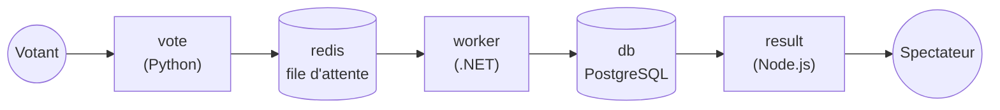

Vous allez déployer la première brique d'une application sur Kubernetes, puis **la casser volontairement** pour voir Kubernetes la réparer sans aucune intervention humaine. À la fin, vous savez écrire un **Deployment**, le transmettre au cluster avec `kubectl apply`, et dire ce qui se passe quand un pod disparaît, quand un conteneur plante et quand on supprime le Deployment lui-même.

**Niveau** : débutant. Aucune connaissance en programmation n'est nécessaire. Vous savez ouvrir un terminal et y lancer une commande ; chaque commande Kubernetes est expliquée quand elle arrive.

**Prérequis** : un cluster Kubernetes qui répond à `kubectl get nodes`, ce que fait le lab [Démarrer son cluster Kubernetes avec minikube](https://byte-layers.com/fr/labs/k8s-minikube-install), et savoir ce que sont une image et un conteneur, ce que rappelle le lab [Échauffement : la voting app en conteneurs](https://byte-layers.com/fr/labs/voting-app-containers-warmup).

**Ce qu'il faut** : un éditeur de texte, un navigateur, `curl` pour interroger une page web depuis le terminal, et le port **28610** de votre machine libre.

## L'application : la voting app

Tout le parcours déploie la même application, la **voting app** : une petite application de vote (« Chats ou Chiens ? ») publiée par Docker comme exemple. Elle est volontairement composée de **5 morceaux écrits dans des technologies différentes**, comme beaucoup d'applications d'entreprise. Ce schéma suit le trajet d'un vote :

| Morceau | Rôle |
|---|---|
| `vote` | la page web où l'on vote |
| `redis` | une file d'attente qui stocke les votes en attendant leur traitement |
| `worker` | un programme qui sort les votes de la file et les enregistre |
| `db` | la base de données qui garde les votes |
| `result` | la page web qui affiche les résultats en direct |

**Dans ce cours, vous ne déployez que `vote`.** La version utilisée ici affiche son numéro de version et le nom du pod qui répond, et contient une page qui simule une panne : vous verrez tout cela en action. La page de vote s'affiche très bien toute seule, mais **ne cliquez pas sur les boutons** : sans `redis` pour recevoir le vote, vous obtiendrez une erreur `Internal Server Error`. C'est normal.

## Comment ça se passe

Cinq étapes à suivre dans l'ordre, environ 1 h 15 en tout : lancer un pod à la main, décrire l'état souhaité dans un fichier, supprimer un pod, faire planter un conteneur, puis supprimer le Deployment et le remettre. Les blocs marqués `# TODO` sont à compléter vous-même, et les gestes qui font l'objet du cours sont à taper vous-même : le bouton de vérification contrôle ensuite l'état réel du cluster, les indices se dévoilent un par un, et la solution reste en dernier recours.

Vos fichiers vivent dans `~/byte-layers/kubernetes/l1/` et y restent à la fin : `vote.deploy.yml`, que vous écrivez, et deux fichiers de notes, `pod-before.txt` et `watch.txt`. Dans le cluster, tout se passe dans le namespace courant, `default`.

**À la fin, le Deployment `vote` reste en place**, avec 1 exemplaire en version 1.0 : le prochain cours du parcours s'en sert. Le fichier complet se trouve aussi dans [`solution/vote.deploy.yml`](../solution/vote.deploy.yml).
