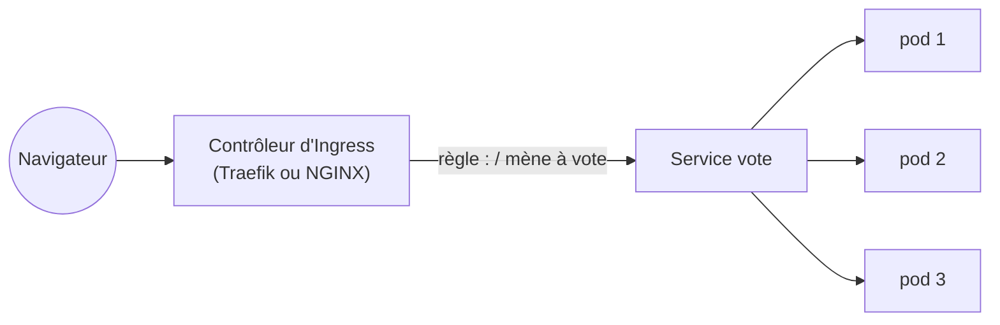

Une porte d'entrée se compose de deux choses : des règles, que vous écrivez, et un programme qui les applique, que le cluster fournit. Vous mettez les deux en place ici.

## Préparer le dossier, vote et son Service

Cette section est un **support** : elle met le cluster dans l'état de départ, et vous pouvez la jouer sans vous y arrêter. Créez d'abord le dossier de travail. `mkdir -p` crée aussi les dossiers parents qui manquent, et ne dit rien si le dossier existe déjà :

```exec
mkdir -p ~/byte-layers/kubernetes/l3
```

Écrivez ensuite le fichier du Deployment `vote` : 3 réplicas, chacun réservant un dixième de processeur et 64 Mi de mémoire.

```exec
cat > ~/byte-layers/kubernetes/l3/vote.deploy.yml <<'EOF'
# vote : 3 réplicas, chacun réservant un dixième de processeur et 64 Mi de mémoire
apiVersion: apps/v1
kind: Deployment
metadata:
  name: vote
  labels:
    app: vote
spec:
  replicas: 3
  selector:
    matchLabels:
      app: vote
  template:
    metadata:
      labels:
        app: vote
    spec:
      containers:
        - name: vote
          image: ghcr.io/bngams/kube-vote:1.0
          ports:
            - containerPort: 80
          resources:
            requests:
              cpu: 100m
              memory: 64Mi
EOF
```

> 🔍 **Comprendre la commande**
>
> | Morceau | Rôle |
> |---|---|
> | `cat` | recopie ce qu'il reçoit en entrée |
> | `> ~/byte-layers/kubernetes/l3/vote.deploy.yml` | envoie cette copie dans le fichier, qu'il crée, ou dont il remplace le contenu s'il existe déjà |
> | `<<'EOF'` | donne en entrée à `cat` toutes les lignes qui suivent, telles quelles, jusqu'à la ligne `EOF` |
> | les lignes entre les deux | le contenu du fichier |
> | `EOF` | marque la fin du contenu ; ce mot n'est pas écrit dans le fichier |

Il faut aussi le **Service** de `vote`. Un Service donne à un groupe de pods un **nom** et une **adresse** qui ne changent pas, joignables seulement de l'intérieur du cluster, et répartit les requêtes entre ces pods. Celui-ci s'appelle `vote`, écoute sur le port 80 et sert tous les pods qui portent l'étiquette `app: vote` :

```exec
cat > ~/byte-layers/kubernetes/l3/vote.svc.yml <<'EOF'
# Une adresse stable, "vote", qui répartit les visiteurs entre tous les pods portant l'étiquette app: vote
apiVersion: v1
kind: Service
metadata:
  name: vote
  labels:
    app: vote
spec:
  selector:
    app: vote
  ports:
    - port: 80
      targetPort: 80
EOF
```

Transmettez les deux fichiers au cluster. Pour ce qui tourne déjà avec ces réglages, `kubectl apply` répond `unchanged` et ne touche à rien :

```exec
kubectl apply -f ~/byte-layers/kubernetes/l3/vote.deploy.yml -f ~/byte-layers/kubernetes/l3/vote.svc.yml
```

Attendez que les 3 pods soient prêts. `kubectl rollout status` suit le déploiement et rend la main quand il est terminé, ou au bout de 120 secondes :

```exec
kubectl rollout status deployment/vote --timeout=120s
```

```ack
vote tourne avec ses 3 réplicas et son Service
```

## Des règles d'aiguillage et un contrôleur qui les applique

Un **Ingress** est un ensemble de **règles d'aiguillage** pour les visites web venues de l'extérieur : « telle adresse mène à tel Service ». Il ne fonctionne pas tout seul : un programme, le **contrôleur d'Ingress**, reçoit réellement les visites et applique ces règles. Ensemble, ils forment la porte d'entrée de votre application, comme le montre ce schéma.



Le contrôleur n'est pas le même selon l'endroit où tourne votre cluster :

| | Sur votre poste (minikube) | Sur un poste hébergé (k3d) |
|---|---|---|
| Contrôleur d'Ingress | NGINX, à activer dans la section suivante | **Traefik**, déjà inclus dans le cluster |
| Adresse de la porte d'entrée | `http://localhost:28632`, par un tunnel vers le contrôleur | le port 8000 du poste, ouvert à la création du cluster |

## Sur votre poste : activer le contrôleur NGINX

Sur un poste hébergé, le contrôleur Traefik tourne déjà : passez directement à la section suivante.

Sur votre poste, minikube fournit le contrôleur NGINX sous forme de module à activer, un *addon*. `-p layers-k8s` désigne votre cluster par le nom de son profil :

```exec
minikube -p layers-k8s addons enable ingress
```

L'activation prend environ une minute la première fois, et une seconde si le module est déjà actif. La commande se termine par cette ligne :

```text
* The 'ingress' addon is enabled
```

Si minikube affiche aussi un message vous invitant à lancer `minikube tunnel`, **ignorez-le** : vous utiliserez à la place un tunnel `kubectl`.

Attendez ensuite que le contrôleur soit prêt. Sinon, l'envoi de votre Ingress échouerait avec un message `failed calling webhook` :

```exec
kubectl wait -n ingress-nginx --for=condition=Ready pod -l app.kubernetes.io/component=controller --timeout=180s
```

> 🔍 **Comprendre la commande**
>
> | Morceau | Rôle |
> |---|---|
> | `kubectl wait` | attend qu'une condition soit remplie, puis rend la main |
> | `-n ingress-nginx` | dans le **namespace** `ingress-nginx`, l'espace de rangement du cluster où minikube a installé le contrôleur |
> | `--for=condition=Ready` | la condition attendue : « le pod est prêt » |
> | `-l app.kubernetes.io/component=controller` | le pod concerné, désigné par son étiquette |
> | `--timeout=180s` | le temps d'attente maximal, 3 minutes |

Le terminal répond quand le pod est prêt :

```text
pod/ingress-nginx-controller-9cc49f96f-rpt2t condition met
```

```ack
Mon cluster a un contrôleur d'Ingress prêt
```

## Écrire le fichier vote.ingress.yml

Un Ingress se compose de **règles** : « les visites qui arrivent sur tel chemin vont vers tel Service ». Ici, une seule règle suffit : tout ce qui arrive sur `/` (la racine du site, donc toutes les pages) part vers le Service `vote`.

| Champ | Rôle |
|---|---|
| `kind: Ingress` | on décrit une porte d'entrée |
| `rules[].host` | facultatif : le nom de domaine demandé, par exemple `vote.example.com`. Sans ce champ, la règle vaut pour tous les noms |
| `rules[].http.paths[].path` | le chemin demandé dans l'adresse. `/` avec `pathType: Prefix` signifie « tout ce qui commence par `/` », donc toutes les pages |
| `backend.service.name` | le Service vers lequel envoyer ces visites |
| `backend.service.port.number` | le port de ce Service (le `port` de `vote.svc.yml`) |

Créez le fichier de départ, avec ses deux blancs :

```exec
cat > ~/byte-layers/kubernetes/l3/vote.ingress.yml <<'EOF'
# La porte d'entrée du cluster : toutes les requêtes reçues sur "/" sont envoyées au Service vote
apiVersion: networking.k8s.io/v1
kind: Ingress
metadata:
  name: vote
spec:
  rules:
    - http:
        paths:
          - path: /
            pathType: Prefix
            backend:
              service:
                name: # TODO : le Service vers lequel envoyer les visiteurs
                port:
                  number: # TODO : le port de ce Service
EOF
```

Ouvrez `~/byte-layers/kubernetes/l3/vote.ingress.yml` dans votre éditeur. Remplacez chaque `# TODO` et tout le texte qui le suit sur la ligne par la bonne valeur, à l'aide du tableau et du fichier `vote.svc.yml` rangé dans le même dossier, puis enregistrez.

```ack
J'ai remplacé les deux TODO et enregistré le fichier
```

## Appliquer l'Ingress

Transmettez le fichier au cluster :

```exec
kubectl apply -f ~/byte-layers/kubernetes/l3/vote.ingress.yml
```

Le terminal doit confirmer la création :

```text
ingress.networking.k8s.io/vote created
```

Listez ensuite les Ingress :

```exec
kubectl get ingress
```

Voici le résultat sur votre poste, puis sur un poste hébergé :

```text
NAME   CLASS     HOSTS   ADDRESS        PORTS   AGE
vote   nginx     *       192.168.49.2   80      30s
vote   traefik   *       172.19.0.2     80      10s
```

La colonne `CLASS` indique le contrôleur qui a pris en charge votre Ingress. Vous n'avez pas eu à le préciser : votre cluster a un contrôleur **par défaut**. La colonne `HOSTS` affiche `*`, car votre règle vaut pour tous les noms. La colonne `ADDRESS` peut rester vide quelques instants sur votre poste.

```hint
Le Service s'appelle comme l'application. Son port est la valeur de `port` dans `vote.svc.yml`.
```

```hint
`name: vote` et `number: 80`. Chaque valeur s'écrit après les deux-points et une espace, à la place du `# TODO`.
```

```verify
if ! kubectl get ingress vote >/dev/null 2>&1; then
  echo "Il n'y a pas d'Ingress vote. Remplacez les TODO de vote.ingress.yml, puis lancez kubectl apply -f ~/byte-layers/kubernetes/l3/vote.ingress.yml et lisez sa réponse."
  echo "Si la réponse mentionne « failed calling webhook », le contrôleur n'est pas prêt : reprenez la section qui l'active."
  exit 1
fi
SVC=$(kubectl get ingress vote -o jsonpath='{.spec.rules[0].http.paths[0].backend.service.name}')
PORT=$(kubectl get ingress vote -o jsonpath='{.spec.rules[0].http.paths[0].backend.service.port.number}')
if [ "$SVC" != "vote" ] || [ "$PORT" != "80" ]; then
  echo "La règle envoie les visites vers le Service « ${SVC:-vide} », port ${PORT:-vide} : il faut le Service vote, port 80."
  exit 1
fi
if kubectl get service -n ingress-nginx ingress-nginx-controller >/dev/null 2>&1; then
  URL=http://ingress-nginx-controller.ingress-nginx/
elif kubectl get service -n kube-system traefik >/dev/null 2>&1; then
  URL=http://traefik.kube-system/
else
  echo "Aucun contrôleur d'Ingress n'a été trouvé dans le cluster. Sur votre poste, reprenez la section « Sur votre poste : activer le contrôleur NGINX »."
  exit 1
fi
OUT=""
for i in 1 2 3; do
  kubectl delete pod l3-ingress-check --ignore-not-found >/dev/null 2>&1
  OUT=$(kubectl run l3-ingress-check --rm -i --quiet --restart=Never --image=ghcr.io/bngams/kube-busybox:1.37 -- wget -qO- -T 5 "$URL" 2>/dev/null)
  case "$OUT" in *'<strong>vote-'*) break ;; esac
  sleep 3
done
case "$OUT" in
  *'<strong>vote-'*) : ;;
  *) echo "L'Ingress vote existe, mais une visite envoyée au contrôleur n'arrive pas à vote. Vérifiez que vote tourne (kubectl get pods) et que son Service existe (kubectl get services), puis réessayez."
     exit 1 ;;
esac
echo "Une visite reçue par le contrôleur d'Ingress arrive bien à un pod de vote."
```

````solution
Le fichier complet, écrit par une commande, puis appliqué :

```bash
cat > ~/byte-layers/kubernetes/l3/vote.ingress.yml <<'EOF'
# La porte d'entrée du cluster : toutes les requêtes reçues sur "/" sont envoyées au Service vote
apiVersion: networking.k8s.io/v1
kind: Ingress
metadata:
  name: vote
spec:
  rules:
    - http:
        paths:
          - path: /
            pathType: Prefix
            backend:
              service:
                name: vote
                port:
                  number: 80
EOF
kubectl apply -f ~/byte-layers/kubernetes/l3/vote.ingress.yml
```
````

> 📖 [Ingress, documentation officielle](https://kubernetes.io/fr/docs/concepts/services-networking/ingress/) · [Les contrôleurs d'Ingress](https://kubernetes.io/docs/concepts/services-networking/ingress-controllers/) (en anglais)
