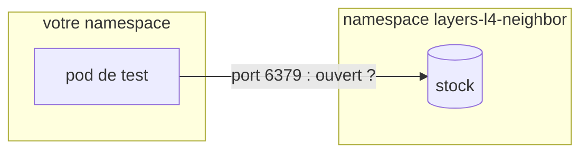

Vous avez rangé votre application dans son namespace. Y est-elle à l'abri des autres pods du cluster ? Vous allez poser la question à un pod de test, lire la réponse du cluster, et savoir ce qu'un namespace sépare vraiment.

**Prérequis** : savoir ce qu'est un Service et comment un pod en joint un autre par son nom, ce qu'enseigne [Donner une adresse stable avec un Service](https://byte-layers.com/fr/skills/k8s-services), et savoir ce qu'est un namespace. Cette page se lit après [Ranger et encadrer avec un namespace et un quota](https://byte-layers.com/fr/skills/k8s-namespaces-quotas). Il vous faut un cluster `layers-k8s` auquel `kubectl` répond.

# Dans un cluster, le réseau est ouvert par défaut

Un Service donne un nom et une adresse stables aux morceaux d'une application. Mais qui a le droit de s'en servir ? Le schéma montre l'expérience de cette page : un pod de test, dans votre namespace, s'adresse à une application rangée dans un autre.



## Une application voisine, dans un autre namespace

Il vous faut d'abord un voisin : une application qui n'est pas la vôtre, dans un namespace qui n'est pas le vôtre. Créez ce namespace :

```exec
kubectl create namespace layers-l4-neighbor
```

Lancez-y une base Redis, que l'on appellera `stock`. `kubectl create deployment` crée un Deployment sans fichier : c'est un raccourci, acceptable pour une démonstration que l'on supprime cinq minutes plus tard, pas pour une vraie application. `-n` adresse la commande au namespace voisin.

```exec
kubectl create deployment stock --image=ghcr.io/bngams/kube-redis:8-alpine -n layers-l4-neighbor
```

Donnez-lui un Service, pour qu'elle ait un nom et une adresse stables. `kubectl expose` est le même raccourci, pour un Service : il crée le Service `stock`, sur le port 6379 de Redis.

```exec
kubectl expose deployment stock --port=6379 -n layers-l4-neighbor
```

Attendez que le voisin soit prêt. `kubectl wait` rend la main quand le Deployment a son pod prêt (`Available`) :

```exec
kubectl wait --for=condition=Available deployment/stock -n layers-l4-neighbor --timeout=120s
```

Le voisin est en place : une base de données, dans son propre namespace, à laquelle personne n'a donné d'accès particulier.

## Un pod de test qui n'a rien à voir avec ce voisin

Lancez maintenant un pod de test dans **votre** namespace, et demandez-lui s'il peut ouvrir une connexion vers la base du voisin. Avant de valider, faites votre prévision : le namespace du voisin le protège-t-il ?

```exec
kubectl run test --rm -i --restart=Never --image=ghcr.io/bngams/kube-busybox:1.37 -- sh -c "nc -z -w 3 stock.layers-l4-neighbor 6379 && echo stock: ouvert || echo stock: bloqué"
```

> 🔍 **Comprendre la commande**
>
> | Morceau | Rôle |
> |---|---|
> | `kubectl run test` | lance un pod nommé `test`, dans votre namespace |
> | `--rm -i --restart=Never` | supprime le pod quand il a fini (`--rm`), affiche ce qu'il écrit (`-i`), et ne le relance pas (`--restart=Never`) |
> | `--image=…/kube-busybox:1.37` | une petite image qui contient des outils réseau |
> | `-- sh -c "…"` | la commande que le pod exécute : tout ce qui est entre guillemets |
> | `nc -z -w 3 stock.layers-l4-neighbor 6379` | `nc` (*netcat*) teste seulement si une connexion est possible (`-z`), sans rien envoyer, et abandonne au bout de 3 secondes (`-w 3`) |
> | `stock.layers-l4-neighbor` | le Service `stock` du namespace `layers-l4-neighbor` : depuis un autre namespace, on ajoute le nom du namespace après un point |
> | `&& echo stock: ouvert` | si la connexion réussit, affiche `stock: ouvert` |
> | `\|\| echo stock: bloqué` | sinon, affiche `stock: bloqué` |

Le terminal affiche la réponse du pod. Avant la réponse, `kubectl` affiche parfois deux lignes en anglais (`All commands and output from this session…`, puis `If you don't see a command prompt, try pressing enter.`) : elles sont sans importance.

```text
stock: ouvert
pod "test" deleted from vote-app namespace
```

La dernière ligne cite votre namespace : `vote-app`, ou `default` si vous y travaillez encore. Le pod de test a joint la base du voisin, depuis un autre namespace, sans que personne ne l'y ait autorisé.

## Pourquoi un réseau ouvert est un problème

> ⚠️ Ce pod de test n'a rien à voir avec l'application du voisin, et il joint pourtant sa base de données. Si un jour un pod est compromis (une faille dans une application, une image piégée), il pourra atteindre **tout** le reste. Par défaut, le réseau de Kubernetes est entièrement ouvert : un namespace range et encadre, il ne ferme pas le réseau.

Votre application de vote est dans la même situation que ce voisin : tant que rien ne ferme le réseau, n'importe quel pod du cluster peut ouvrir une connexion vers sa base `db` ou vers `redis`. Le tableau résume ce qu'un namespace sépare, et ce qu'il laisse passer :

| Un namespace sépare | Un namespace ne sépare pas |
|---|---|
| les noms : deux `stock` peuvent exister dans deux namespaces | le réseau : un pod joint un Service d'un autre namespace par `nom.namespace` |
| les quotas : chaque namespace a son plafond | |
| les droits : qui peut faire quoi, namespace par namespace | |

Fermer ce réseau demande un objet à part, la **NetworkPolicy**, une règle qui dit quels pods ont le droit d'en contacter d'autres, et sur quel port.

## Supprimer le voisin

Supprimez ce que cette page a créé. Supprimer un namespace supprime **tout ce qu'il contient**, ici le Deployment et le Service `stock` ; la commande peut mettre une trentaine de secondes à rendre la main.

```exec
kubectl delete namespace layers-l4-neighbor
```

> 📖 [Le réseau d'un cluster](https://kubernetes.io/docs/concepts/services-networking/) · [Le nom DNS d'un Service](https://kubernetes.io/docs/concepts/services-networking/dns-pod-service/) · [Les NetworkPolicies](https://kubernetes.io/docs/concepts/services-networking/network-policies/)

## Récap

- Par défaut, tout pod d'un cluster peut ouvrir une connexion vers tout autre pod : **le réseau est ouvert**.
- Le Service ne fait que donner un nom à l'application : depuis un autre namespace, ce nom s'écrit `service.namespace`.
- Un namespace range et encadre, il **ne ferme pas le réseau**.
- Un pod compromis peut donc atteindre tout le reste, tant qu'aucune NetworkPolicy ne l'en empêche.

```quiz
prompt: "Une équipe range sa base de données dans son propre namespace, sans rien configurer d'autre. Un pod d'un autre namespace peut-il ouvrir une connexion vers cette base ?"
answers:
  - "Non : un namespace isole le réseau de ce qu'il contient"
  - "Oui : par défaut, tout pod du cluster peut joindre tout autre pod, d'un namespace à l'autre"
  - "Oui, mais seulement s'il porte la même étiquette que la base"
correct: 2
explanation: |
  Un namespace sépare les noms, les quotas et les droits, pas le réseau. Sans NetworkPolicy, la base est joignable par tous les pods du cluster, sous le nom `service.namespace`.
```

```ack
J'ai compris
```
