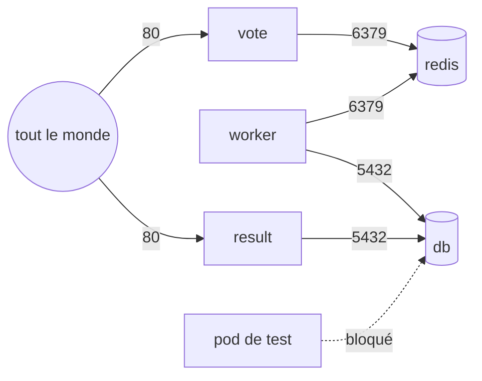

Une **NetworkPolicy** est une règle réseau qui dit, pour un groupe de pods : « qui a le droit de me contacter, et sur quel port ». La bonne pratique tient en une phrase : **tout fermer, puis n'ouvrir que le nécessaire**. Vous allez d'abord manipuler ces règles dans un éditeur visuel, puis écrire celles de l'application de vote.

## Décrire une règle dans l'éditeur visuel

Avant d'appliquer quoi que ce soit, prenez une dizaine de minutes pour manipuler l'éditeur visuel [editor.networkpolicy.io](https://editor.networkpolicy.io/). Il ne demande aucun compte, il ne touche pas à votre cluster, et son interface est en anglais. Le tableau vous dit où regarder :

| Zone de l'éditeur | Rôle |
|---|---|
| la boîte du **centre** | les pods concernés par la règle (*Pod selector*), que l'on choisit avec **Edit** |
| les trois boîtes de **gauche** | les règles **entrantes** (*ingress*) : qui peut contacter ces pods, depuis l'extérieur du cluster (*Outside Cluster*), depuis leur namespace (*In Namespace*) ou depuis le reste du cluster (*In Cluster*) |
| les trois boîtes de **droite** | les règles **sortantes** (*egress*) : qui ces pods peuvent contacter |
| **+ Add rule**, sur chaque boîte | ajouter une règle |
| le bas de l'écran | le **YAML** correspondant, mis à jour en direct |

La page d'accueil du site, [networkpolicy.io](https://networkpolicy.io/), propose aussi des tutoriels pas à pas, sous le titre *Learn with a guided tutorial*.

Suivez le début du premier tutoriel, *Main tutorial*, puis revenez dans l'éditeur et essayez de décrire cette règle : « les pods `app: db` n'acceptent que les connexions venant des pods `app: worker` et `app: result`, sur le port 5432 ». Regardez le YAML se construire en bas de l'écran : c'est cette règle que vous écrirez vous-même à la fin de cette étape. L'éditeur désigne `worker` et `result` par deux `podSelector` l'un sous l'autre, là où le fichier de l'application les réunit dans une seule liste : les deux écritures disent la même chose.

Cet exercice est un entraînement : rien n'y est vérifié, et vous pouvez y revenir quand vous aurez écrit la règle à la main.

```ack
J'ai manipulé l'éditeur visuel
```

## Créer le fichier de départ et lire ses deux premières règles

L'application de vote a besoin de quatre règles. Le schéma montre les flux qu'elles laissent passer, avec le port de chacun, et celui qu'elles doivent bloquer :



Chaque flèche pleine devient une autorisation, écrite dans une NetworkPolicy :

| NetworkPolicy | Règle |
|---|---|
| `tout-fermer` | par défaut, aucun pod du namespace n'accepte de connexion entrante |
| `pages-web-ouvertes` | `vote` et `result` acceptent tout le monde, sur le port 80 (ce sont les pages web) |
| `redis-pour-vote-et-worker` | `redis` n'accepte que `vote` et `worker`, sur le port 6379 |
| `db-pour-worker-et-result` | `db` n'accepte que `worker` et `result`, sur le port 5432 |

Les quatre vont dans un seul fichier, `vote-app.netpol.yml`, séparées par des lignes qui commencent par `---` ; ce qui suit le `#` sur ces lignes est un commentaire. Les deux premières vous sont données, la troisième a deux blancs, et la quatrième est à écrire. Créez ce fichier de départ :

```exec
cat > ~/byte-layers/kubernetes/l4/vote-app.netpol.yml <<'EOF'
# Règles réseau de l'application de vote : tout est fermé par défaut, puis on n'ouvre que les flux utiles.
# 1. Par défaut, aucun pod du namespace n'accepte de connexion entrante.
apiVersion: networking.k8s.io/v1
kind: NetworkPolicy
metadata:
  name: tout-fermer
spec:
  podSelector: {}            # tous les pods du namespace
  policyTypes: [Ingress]     # règles sur le trafic ENTRANT
--- # règle 2
# 2. vote et result sont les pages web : ouvertes à tous, sur le port 80.
apiVersion: networking.k8s.io/v1
kind: NetworkPolicy
metadata:
  name: pages-web-ouvertes
spec:
  podSelector:
    matchExpressions:
      - { key: app, operator: In, values: [vote, result] }
  policyTypes: [Ingress]
  ingress:
    - ports:
        - port: 80
--- # règle 3
# 3. redis n'accepte que vote et worker.
apiVersion: networking.k8s.io/v1
kind: NetworkPolicy
metadata:
  name: redis-pour-vote-et-worker
spec:
  podSelector:
    matchLabels: { app: redis }
  policyTypes: [Ingress]
  ingress:
    - from:
        - podSelector:
            matchExpressions:
              # TODO : la ligne qui désigne les pods dont l'étiquette app vaut vote ou worker
      ports:
        # TODO : le port de redis
--- # règle 4
# 4. db n'accepte que worker et result.
# TODO : écrire cette règle en entier, sur le modèle de la règle 3
EOF
```

Ouvrez `~/byte-layers/kubernetes/l4/vote-app.netpol.yml` dans votre éditeur de texte, et lisez les deux premières règles à l'aide de ce tableau :

| Champ | Rôle |
|---|---|
| `podSelector` | les pods que la règle protège, désignés par leurs étiquettes. `{}` veut dire : tous les pods du namespace |
| `matchLabels: { app: redis }` | les pods dont l'étiquette `app` vaut `redis` |
| `matchExpressions`, avec `operator: In` | les pods dont l'étiquette `app` vaut **l'une** des valeurs de la liste `values` |
| `policyTypes: [Ingress]` | la règle porte sur le trafic **entrant** de ces pods. Ce mot n'a rien à voir avec l'objet Ingress, la porte d'entrée du cluster : il veut seulement dire « entrant » |
| `ingress` | la liste de ce qui a le droit d'entrer. Sans ce champ, rien n'entre : c'est toute la règle `tout-fermer` |
| `ports` | le port sur lequel on a le droit d'entrer |
| `from` | qui a le droit d'entrer, désigné lui aussi par ses étiquettes. Sans ce champ, tout le monde : c'est la règle `pages-web-ouvertes` |
| `from` et `ports` sous le **même tiret** | les deux conditions se cumulent : ces pods-là **et** ce port-là. Écrits sous deux tirets différents, ils deviendraient deux autorisations séparées : ces pods-là sur tous les ports, **ou** tout le monde sur ce port |

Les accolades et les crochets sont l'écriture compacte de YAML, sur une seule ligne : `matchLabels: { app: redis }` dit la même chose que `app: redis` écrit une ligne plus bas, décalé sous `matchLabels:`.

Deux choses expliquent comment ces règles se combinent. Tant qu'aucune règle ne désigne un pod, il accepte tout : c'est le réseau ouvert de l'étape précédente. Dès qu'une règle le désigne, il n'accepte plus que ce qu'une règle autorise, et **les autorisations s'additionnent**. `tout-fermer` désigne tous les pods sans rien autoriser ; chaque règle suivante ne rouvre que les flux qu'elle nomme.

## Compléter la règle de redis

La troisième règle protège `redis`. Elle doit laisser entrer `vote`, qui y dépose les votes, et `worker`, qui les en sort, sur le port de Redis, et personne d'autre. Dans votre éditeur, remplacez ses deux lignes `# TODO` : la première par la ligne qui désigne les pods `vote` et `worker`, la seconde par la ligne du port. La règle `pages-web-ouvertes`, juste au-dessus, contient deux lignes de la même forme. Gardez le décalage des lignes `# TODO` que vous remplacez : en YAML, c'est lui qui dit ce qui appartient à quoi.

Enregistrez le fichier, puis appliquez-le :

```exec
kubectl apply -f ~/byte-layers/kubernetes/l4/vote-app.netpol.yml
```

Listez ensuite les règles du namespace :

```exec
kubectl get networkpolicies
```

Les trois premières règles sont là. La colonne `POD-SELECTOR` dit quels pods chacune protège, et `<none>` veut dire tous :

```text
NAME                        POD-SELECTOR           AGE
pages-web-ouvertes          app in (result,vote)   0s
redis-pour-vote-et-worker   app=redis              0s
tout-fermer                 <none>                 0s
```

```hint
Regardez le schéma : deux flèches arrivent sur `redis`. Elles vous donnent les deux morceaux à autoriser, et le port.
```

```hint
Les deux lignes à écrire existent déjà, à une valeur près, dans la règle `pages-web-ouvertes` : une ligne `- { key: app, operator: In, values: [...] }` et une ligne `- port: ...`.
```

```hint
Sous `matchExpressions:`, la liste `values` contient les deux morceaux qui parlent à redis : `vote` et `worker`. Sous `ports:`, le port de Redis est 6379.
```

```verify
NS=vote-app
names=$(kubectl get networkpolicy -n "$NS" -o jsonpath='{.items[*].metadata.name}' 2>/dev/null)
if [ -z "$names" ]; then
  echo "Aucune règle réseau dans le namespace vote-app."
  echo "Appliquez votre fichier : kubectl apply -f ~/byte-layers/kubernetes/l4/vote-app.netpol.yml"
  exit 1
fi
if ! kubectl get networkpolicy -n "$NS" -o jsonpath='{range .items[*]}{.spec.podSelector}{"|"}{.spec.ingress}{"\n"}{end}' | grep -qx '{}|'; then
  echo "Aucune règle ne ferme tout le namespace : il manque tout-fermer, la première règle du fichier de départ."
  exit 1
fi
pol=""
for p in $names; do
  target=$(kubectl get networkpolicy "$p" -n "$NS" -o jsonpath='{.spec.podSelector.matchLabels.app}{.spec.podSelector.matchExpressions[*].values[*]}')
  if [ "$target" = "redis" ]; then pol="$p"; fi
done
if [ -z "$pol" ]; then
  echo "Aucune règle ne protège les pods app=redis. La troisième règle du fichier doit garder son podSelector."
  exit 1
fi
who=$(kubectl get networkpolicy "$pol" -n "$NS" -o jsonpath='{.spec.ingress[*].from[*].podSelector.matchLabels.app} {.spec.ingress[*].from[*].podSelector.matchExpressions[*].values[*]}' | tr ' ' '\n' | grep . | sort -u | tr '\n' ' ')
if [ "$who" != "vote worker " ]; then
  echo "La règle $pol doit laisser entrer les pods vote et worker, et eux seuls (trouvé : ${who:-personne de précis})."
  echo "Remplacez le premier TODO par une ligne - { key: app, operator: In, values: [...] }, puis réappliquez le fichier."
  exit 1
fi
open=$(kubectl get networkpolicy "$pol" -n "$NS" -o jsonpath='{range .spec.ingress[*]}{.from}{"\n"}{end}{range .spec.ingress[*].from[*]}{.podSelector}{.namespaceSelector}{.ipBlock}{"\n"}{end}')
if printf '%s\n' "$open" | grep -qx -e '' -e '{}'; then
  echo "La règle $pol contient une autorisation sans condition : elle laisse entrer plus que vote et worker."
  echo "from et ports doivent être sous le même tiret, et chaque élément de from doit désigner des pods par leur étiquette app."
  exit 1
fi
ports=$(kubectl get networkpolicy "$pol" -n "$NS" -o jsonpath='{.spec.ingress[*].ports[*].port}')
if [ "$ports" != "6379" ]; then
  echo "La règle $pol doit ouvrir le port 6379, celui de Redis, et lui seul (trouvé : ${ports:-tous les ports})."
  echo "Remplacez le second TODO par une ligne - port: ..., puis réappliquez le fichier."
  exit 1
fi
echo "redis n'accepte plus que vote et worker, sur le port 6379."
```

````solution
La première ligne désigne les pods dont l'étiquette `app` vaut `vote` ou `worker`, la seconde donne le port de Redis. La quatrième règle reste à écrire.

```bash
cat > ~/byte-layers/kubernetes/l4/vote-app.netpol.yml <<'EOF'
# Règles réseau de l'application de vote : tout est fermé par défaut, puis on n'ouvre que les flux utiles.
# 1. Par défaut, aucun pod du namespace n'accepte de connexion entrante.
apiVersion: networking.k8s.io/v1
kind: NetworkPolicy
metadata:
  name: tout-fermer
spec:
  podSelector: {}            # tous les pods du namespace
  policyTypes: [Ingress]     # règles sur le trafic ENTRANT
--- # règle 2
# 2. vote et result sont les pages web : ouvertes à tous, sur le port 80.
apiVersion: networking.k8s.io/v1
kind: NetworkPolicy
metadata:
  name: pages-web-ouvertes
spec:
  podSelector:
    matchExpressions:
      - { key: app, operator: In, values: [vote, result] }
  policyTypes: [Ingress]
  ingress:
    - ports:
        - port: 80
--- # règle 3
# 3. redis n'accepte que vote et worker.
apiVersion: networking.k8s.io/v1
kind: NetworkPolicy
metadata:
  name: redis-pour-vote-et-worker
spec:
  podSelector:
    matchLabels: { app: redis }
  policyTypes: [Ingress]
  ingress:
    - from:
        - podSelector:
            matchExpressions:
              - { key: app, operator: In, values: [vote, worker] }
      ports:
        - port: 6379
--- # règle 4
# 4. db n'accepte que worker et result.
# TODO : écrire cette règle en entier, sur le modèle de la règle 3
EOF
kubectl apply -f ~/byte-layers/kubernetes/l4/vote-app.netpol.yml
```
````

## Écrire la règle de db

Il manque une règle. `tout-fermer` s'applique aussi à `db`, et aucune règle ne lui rouvre quoi que ce soit : plus personne ne peut ouvrir de connexion vers la base, pas même `worker` et `result`, qui en ont besoin. Vérifiez-le avec un pod de test qui se présente comme `worker` : l'option `--labels` lui colle l'étiquette `app=worker`, et il essaie de joindre `db`.

```exec
kubectl run test --labels=app=worker --rm -i --restart=Never --image=ghcr.io/bngams/kube-busybox:1.37 -- sh -c "nc -z -w 3 db 5432 && echo db: ouvert || echo db: bloqué"
```

Même avec l'étiquette de `worker`, la base ne répond pas :

```text
db: bloqué
pod "test" deleted from vote-app namespace
```

Écrivez la quatrième règle à la fin du fichier, à la place de la dernière ligne `# TODO`. C'est celle que vous avez décrite dans l'éditeur visuel : les pods `app: db` n'acceptent que les connexions venant des pods `app: worker` et `app: result`, sur le port 5432. Elle a la même forme que la règle de `redis` que vous venez de compléter ; nommez-la `db-pour-worker-et-result`.

Enregistrez le fichier, puis appliquez-le de nouveau :

```exec
kubectl apply -f ~/byte-layers/kubernetes/l4/vote-app.netpol.yml
```

`kubectl` répond `created` pour la nouvelle règle. Listez les règles :

```exec
kubectl get networkpolicies
```

Vous devez maintenant en lire quatre, celle de `db` en tête :

```text
NAME                        POD-SELECTOR           AGE
db-pour-worker-et-result    app=db                 0s
pages-web-ouvertes          app in (result,vote)   11s
redis-pour-vote-et-worker   app=redis              11s
tout-fermer                 <none>                 11s
```

```hint
Une règle répond à trois questions : quels pods protège-t-elle, qui laisse-t-elle entrer, et sur quel port ? Le schéma donne les trois réponses pour `db`.
```

```hint
Recopiez la règle de `redis` à la fin du fichier, sous la ligne `--- # règle 4`, puis changez quatre choses : le nom, l'étiquette du `podSelector`, la liste `values` et le port.
```

```hint
Le `podSelector` de la règle désigne `db`. Sous `from`, la liste `values` contient `worker` et `result`. Le port de PostgreSQL est 5432. Si la vérification parle d'une « autorisation sans condition », `from` et `ports` ne sont pas sous le même tiret : seul `from` est précédé d'un tiret, et `ports` est aligné sous lui.
```

```verify
NS=vote-app
names=$(kubectl get networkpolicy -n "$NS" -o jsonpath='{.items[*].metadata.name}' 2>/dev/null)
if [ -z "$names" ]; then
  echo "Aucune règle réseau dans le namespace vote-app."
  echo "Appliquez votre fichier : kubectl apply -f ~/byte-layers/kubernetes/l4/vote-app.netpol.yml"
  exit 1
fi
pol=""
for p in $names; do
  target=$(kubectl get networkpolicy "$p" -n "$NS" -o jsonpath='{.spec.podSelector.matchLabels.app}{.spec.podSelector.matchExpressions[*].values[*]}')
  if [ "$target" = "db" ]; then pol="$p"; fi
done
if [ -z "$pol" ]; then
  echo "Aucune règle ne protège les pods app=db : la quatrième règle manque, ou son podSelector ne désigne pas db."
  echo "Écrivez-la à la fin du fichier, puis réappliquez-le."
  exit 1
fi
who=$(kubectl get networkpolicy "$pol" -n "$NS" -o jsonpath='{.spec.ingress[*].from[*].podSelector.matchLabels.app} {.spec.ingress[*].from[*].podSelector.matchExpressions[*].values[*]}' | tr ' ' '\n' | grep . | sort -u | tr '\n' ' ')
if [ "$who" != "result worker " ]; then
  echo "La règle $pol doit laisser entrer les pods worker et result, et eux seuls (trouvé : ${who:-personne de précis})."
  exit 1
fi
open=$(kubectl get networkpolicy "$pol" -n "$NS" -o jsonpath='{range .spec.ingress[*]}{.from}{"\n"}{end}{range .spec.ingress[*].from[*]}{.podSelector}{.namespaceSelector}{.ipBlock}{"\n"}{end}')
if printf '%s\n' "$open" | grep -qx -e '' -e '{}'; then
  echo "La règle $pol contient une autorisation sans condition : elle laisse entrer plus que worker et result."
  echo "from et ports doivent être sous le même tiret, et chaque élément de from doit désigner des pods par leur étiquette app."
  exit 1
fi
ports=$(kubectl get networkpolicy "$pol" -n "$NS" -o jsonpath='{.spec.ingress[*].ports[*].port}')
if [ "$ports" != "5432" ]; then
  echo "La règle $pol doit ouvrir le port 5432, celui de PostgreSQL, et lui seul (trouvé : ${ports:-tous les ports})."
  exit 1
fi
if ! kubectl get networkpolicy -n "$NS" -o jsonpath='{range .items[*]}{.spec.podSelector}{"|"}{.spec.ingress}{"\n"}{end}' | grep -qx '{}|'; then
  echo "La règle de db est juste, mais plus aucune règle ne ferme tout le namespace : tout-fermer a disparu. Réappliquez le fichier complet."
  exit 1
fi
echo "db n'accepte plus que worker et result, sur le port 5432. Les règles de l'application sont en place."
```

````solution
La quatrième règle reprend la forme de la troisième, avec `db`, `worker` et `result`, et le port 5432.

```bash
cat > ~/byte-layers/kubernetes/l4/vote-app.netpol.yml <<'EOF'
# Règles réseau de l'application de vote : tout est fermé par défaut, puis on n'ouvre que les flux utiles.
# 1. Par défaut, aucun pod du namespace n'accepte de connexion entrante.
apiVersion: networking.k8s.io/v1
kind: NetworkPolicy
metadata:
  name: tout-fermer
spec:
  podSelector: {}            # tous les pods du namespace
  policyTypes: [Ingress]     # règles sur le trafic ENTRANT
--- # règle 2
# 2. vote et result sont les pages web : ouvertes à tous, sur le port 80.
apiVersion: networking.k8s.io/v1
kind: NetworkPolicy
metadata:
  name: pages-web-ouvertes
spec:
  podSelector:
    matchExpressions:
      - { key: app, operator: In, values: [vote, result] }
  policyTypes: [Ingress]
  ingress:
    - ports:
        - port: 80
--- # règle 3
# 3. redis n'accepte que vote et worker.
apiVersion: networking.k8s.io/v1
kind: NetworkPolicy
metadata:
  name: redis-pour-vote-et-worker
spec:
  podSelector:
    matchLabels: { app: redis }
  policyTypes: [Ingress]
  ingress:
    - from:
        - podSelector:
            matchExpressions:
              - { key: app, operator: In, values: [vote, worker] }
      ports:
        - port: 6379
--- # règle 4
# 4. db n'accepte que worker et result.
apiVersion: networking.k8s.io/v1
kind: NetworkPolicy
metadata:
  name: db-pour-worker-et-result
spec:
  podSelector:
    matchLabels: { app: db }
  policyTypes: [Ingress]
  ingress:
    - from:
        - podSelector:
            matchExpressions:
              - { key: app, operator: In, values: [worker, result] }
      ports:
        - port: 5432
EOF
kubectl apply -f ~/byte-layers/kubernetes/l4/vote-app.netpol.yml
```
````

> 📖 [Les NetworkPolicies, documentation officielle](https://kubernetes.io/docs/concepts/services-networking/network-policies/) · [L'éditeur visuel de NetworkPolicies](https://editor.networkpolicy.io/)
