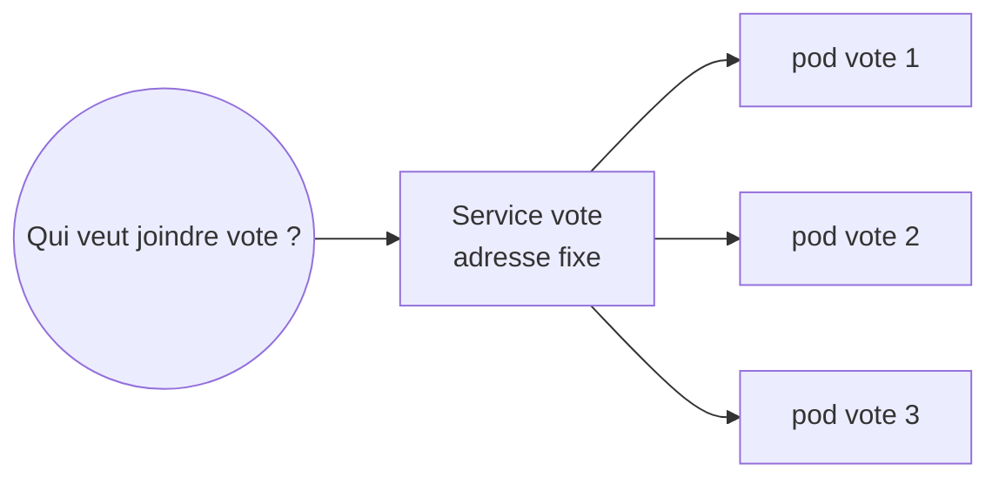

Il faut un intermédiaire stable entre ceux qui appellent `vote` et les pods qui répondent. Dans Kubernetes, cet intermédiaire est un objet à part entière : le **Service**. Vous l'écrivez ici, puis vous l'essayez depuis l'intérieur du cluster.

## Ce que décrit un Service

Un **Service** porte un **nom** (par exemple `vote`) et une **adresse fixe**, qui ne changent pas tant que le Service existe. Il repère les pods à servir grâce à leur **étiquette**, exactement comme le Deployment, et répartit les requêtes entre eux. Le schéma montre le trajet d'une requête.



Les champs d'un Service se lisent ainsi :

| Champ | Rôle |
|---|---|
| `kind: Service` | on décrit un Service |
| `metadata.name` | son nom, qui devient aussi son **nom d'hôte** dans le cluster : les autres pods pourront le joindre à l'adresse `http://vote` |
| `spec.selector` | les pods à servir : tous ceux qui portent cette étiquette, maintenant et à l'avenir |
| `spec.ports[].port` | le port sur lequel le Service écoute |
| `spec.ports[].targetPort` | le port des pods vers lequel il renvoie les requêtes (le `containerPort` du Deployment) |

## Écrire le fichier vote.svc.yml

Créez le fichier de départ, avec ses trois blancs. La commande est la même que pour `vote.deploy.yml` à l'étape précédente : elle écrit dans le fichier tout ce qui se trouve avant la ligne `EOF`.

```exec
cat > ~/byte-layers/kubernetes/l3/vote.svc.yml <<'EOF'
# Une adresse stable, "vote", qui répartit les visiteurs entre tous les pods portant l'étiquette app: vote
apiVersion: v1
kind: Service
metadata:
  name: # TODO : le nom du Service, le même que celui de l'application
  labels:
    app: vote
spec:
  selector:
    app: # TODO : l'étiquette que portent les pods de vote
  ports:
    - port: 80
      targetPort: # TODO : le port de l'application dans le conteneur (le containerPort de vote.deploy.yml)
EOF
```

Ouvrez `~/byte-layers/kubernetes/l3/vote.svc.yml` dans votre éditeur. Remplacez chaque `# TODO` et tout le texte qui le suit sur la ligne par la bonne valeur, à l'aide du tableau ci-dessus et du fichier `vote.deploy.yml` rangé dans le même dossier, puis enregistrez.

```ack
J'ai remplacé les trois TODO et enregistré le fichier
```

## Appliquer le Service et lire ses Endpoints

Transmettez le fichier au cluster :

```exec
kubectl apply -f ~/byte-layers/kubernetes/l3/vote.svc.yml
```

Le terminal doit confirmer la création :

```text
service/vote created
```

Si `apply` échoue avec un message qui mentionne `name`, le nom a été laissé vide en retirant le `# TODO` : complétez-le, enregistrez, et relancez la commande.

Listez ensuite les Services :

```exec
kubectl get services
```

Votre Service `vote` a reçu une adresse fixe dans la colonne `CLUSTER-IP`, différente chez vous (sur un poste hébergé, elle commence par `10.43.`) :

```text
NAME         TYPE        CLUSTER-IP       EXTERNAL-IP   PORT(S)   AGE
kubernetes   ClusterIP   10.96.0.1        <none>        443/TCP   2h
vote         ClusterIP   10.111.166.221   <none>        80/TCP    5s
```

La colonne `PORT(S)` rappelle le port d'écoute ; `TCP` est le protocole de transport utilisé, vous pouvez l'ignorer. Le type `ClusterIP` signifie que cette adresse n'est joignable **qu'à l'intérieur du cluster**. Le Service `kubernetes` existait déjà : c'est celui de Kubernetes lui-même, n'y touchez pas.

Demandez le détail du Service pour voir à qui il transmet les requêtes :

```exec
kubectl describe service vote
```

Parmi les lignes affichées, repérez celles-ci :

```text
Selector:                 app=vote
IP:                       10.111.166.221
Endpoints:                10.244.218.90:80,10.244.218.89:80,10.244.218.93:80
```

La ligne `Endpoints` liste les adresses des **3 pods** actuellement servis : ce sont celles de `kubectl get pods -o wide`. Kubernetes la tient à jour tout seul : quand un pod est remplacé, son ancienne adresse disparaît de la liste et la nouvelle y entre.

> ⚠️ **`Endpoints` est vide (`<none>`) ?** Le `selector` ne correspond à aucun pod : vérifiez qu'il indique bien `app: vote`, enregistrez, puis relancez `kubectl apply`.

```hint
Le nom du Service et l'étiquette des pods sont le même mot : celui de l'application. L'étiquette se lit dans `vote.deploy.yml`, sous `template.metadata.labels`.
```

```hint
Le `targetPort` est le `containerPort` de `vote.deploy.yml` : 80. Chaque valeur s'écrit après les deux-points et une espace, à la place du `# TODO`.
```

```verify
if ! kubectl get service vote >/dev/null 2>&1; then
  echo "Il n'y a pas de Service vote. Remplacez les TODO de vote.svc.yml, puis lancez kubectl apply -f ~/byte-layers/kubernetes/l3/vote.svc.yml et lisez sa réponse."
  exit 1
fi
SEL=$(kubectl get service vote -o jsonpath='{.spec.selector.app}')
if [ "$SEL" != "vote" ]; then
  echo "Le selector du Service vote est « app: ${SEL:-vide} » : il doit désigner l'étiquette app: vote des pods."
  exit 1
fi
PORT=$(kubectl get service vote -o jsonpath='{.spec.ports[0].port}')
TARGET=$(kubectl get service vote -o jsonpath='{.spec.ports[0].targetPort}')
if [ "$PORT" != "80" ] || [ "$TARGET" != "80" ]; then
  echo "Le Service vote écoute sur le port ${PORT:-?} et renvoie vers le port ${TARGET:-?} des pods : il faut 80 et 80."
  exit 1
fi
WANT=$(kubectl get deployment vote -o jsonpath='{.status.readyReplicas}' 2>/dev/null)
HAVE=$(kubectl get endpointslices -l kubernetes.io/service-name=vote -o jsonpath='{range .items[*].endpoints[*]}{.addresses[0]}{"\n"}{end}' | grep -c .)
if [ -z "$WANT" ] || [ "$HAVE" -lt 1 ] || [ "$HAVE" != "$WANT" ]; then
  echo "Le Service vote sert $HAVE pod(s), alors que le Deployment vote en a ${WANT:-0} de prêt(s). Vérifiez que vote tourne : kubectl get pods."
  exit 1
fi
echo "Le Service vote transmet les requêtes à ses $HAVE pods."
```

````solution
Le fichier complet, écrit par une commande, puis appliqué :

```bash
cat > ~/byte-layers/kubernetes/l3/vote.svc.yml <<'EOF'
# Une adresse stable, "vote", qui répartit les visiteurs entre tous les pods portant l'étiquette app: vote
apiVersion: v1
kind: Service
metadata:
  name: vote
  labels:
    app: vote
spec:
  selector:
    app: vote
  ports:
    - port: 80
      targetPort: 80
EOF
kubectl apply -f ~/byte-layers/kubernetes/l3/vote.svc.yml
```
````

> 📖 [Les Services, documentation officielle](https://kubernetes.io/fr/docs/concepts/services-networking/service/)

## Voir la répartition depuis l'intérieur du cluster

Le Service n'est joignable que depuis l'intérieur du cluster. Pour l'essayer, vous lancez un petit pod de test, qui appelle 6 fois l'adresse `http://vote/healthz` puis disparaît. La page `/healthz` de l'application renvoie le nom du pod qui répond.

Faites une prévision avant de lancer : sur 6 appels, est-ce toujours le même pod qui répondra ?

```exec
kubectl run test --rm -i --restart=Never --image=ghcr.io/bngams/kube-busybox:1.37 -- sh -c "for i in 1 2 3 4 5 6; do wget -qO- http://vote/healthz; done"
```

> 🔍 **Comprendre la commande**
>
> | Morceau | Rôle |
> |---|---|
> | `kubectl run test` | lance un pod nommé `test`, sans Deployment : il ne sert qu'une fois |
> | `-i` | affiche la sortie du pod dans votre terminal |
> | `--rm` | supprime le pod dès qu'il a fini |
> | `--restart=Never` | ne relance pas le pod une fois sa commande terminée |
> | `--image=…kube-busybox:1.37` | une toute petite image qui contient des outils de base, dont `wget` pour appeler une adresse web |
> | `--` | sépare les options de `kubectl` de la commande à lancer dans le pod |
> | `sh -c "…"` | fait exécuter par un shell, dans le pod, la phrase entre guillemets |
> | `for i in 1 2 3 4 5 6; do …; done` | répète 6 fois ce qui se trouve entre `do` et `done` |
> | `wget -qO- http://vote/healthz` | appelle l'adresse et affiche la réponse ; `-q` retire les messages de `wget`, `-O-` envoie la réponse à l'écran plutôt que dans un fichier |

Le terminal affiche 6 réponses, puis la suppression du pod de test. Le premier lancement prend quelques secondes de plus, le temps de télécharger l'image. Si des lignes d'avertissement s'affichent avant les réponses, ignorez-les : seules les 6 réponses comptent. Si le terminal répond `AlreadyExists`, un pod `test` est resté d'un lancement interrompu : supprimez-le avec `kubectl delete pod test`, puis recommencez.

```text
{"hostname":"vote-fc57495c-r6x2b","status":"ok","version":"1.0"}
{"hostname":"vote-fc57495c-hjvvd","status":"ok","version":"1.0"}
{"hostname":"vote-fc57495c-pg7gv","status":"ok","version":"1.0"}
{"hostname":"vote-fc57495c-r6x2b","status":"ok","version":"1.0"}
{"hostname":"vote-fc57495c-r6x2b","status":"ok","version":"1.0"}
{"hostname":"vote-fc57495c-r6x2b","status":"ok","version":"1.0"}
pod "test" deleted from default namespace
```

Les noms des pods changent d'une réponse à l'autre : le Service **répartit les requêtes** entre les 3 réplicas. La répartition se fait au hasard, donc vous verrez peut-être deux fois de suite le même pod. Relancez la commande si un pod manque à l'appel.

```ack
J'ai vu plusieurs pods répondre à la même adresse
```

## Le DNS du cluster : trouver un Service par son nom

Comment le pod de test a-t-il trouvé `vote` ? Il a simplement utilisé le **nom** du Service. Le cluster contient un annuaire, un serveur **DNS**, qui traduit automatiquement chaque nom de Service en son adresse fixe.

Posez la question à cet annuaire vous-même. `nslookup` demande l'adresse qui correspond à un nom, ici le nom complet du Service :

```exec
kubectl run test --rm -i --restart=Never --image=ghcr.io/bngams/kube-busybox:1.37 -- nslookup vote.default.svc.cluster.local
```

L'annuaire, qui répond lui-même à l'adresse `10.96.0.10`, donne l'adresse du Service : c'est celle de la colonne `CLUSTER-IP` de `kubectl get services`.

```text
Server:		10.96.0.10
Address:	10.96.0.10:53

Name:	vote.default.svc.cluster.local
Address: 10.111.166.221

pod "test" deleted from default namespace
```

Le nom complet d'un Service se lit de gauche à droite :

| Morceau du nom | Ce qu'il désigne |
|---|---|
| `vote` | le Service |
| `default` | son **namespace**, l'espace de rangement du cluster où il a été créé ; `default` est celui qu'on utilise quand on n'en précise aucun |
| `svc` | le mot qui range tous les Services |
| `cluster.local` | le suffixe du cluster |

Le nom court `vote` suffit depuis un pod du même namespace, et c'est celui qu'on écrit presque toujours.

> 🧠 **C'est ainsi que les morceaux d'une application se trouvent.** Un programme qui a besoin d'une base de données n'a pas à connaître son adresse IP : il appelle le nom de son Service, `db` par exemple, et le DNS du cluster fait le reste. Les pods peuvent être remplacés autant de fois qu'il le faut, le nom ne change pas.

```ack
J'ai retrouvé l'adresse du Service à partir de son nom
```

> 📖 [Le DNS pour les Services et les pods](https://kubernetes.io/docs/concepts/services-networking/dns-pod-service/) (en anglais) · [`kubectl run`](https://kubernetes.io/docs/reference/kubectl/generated/kubectl_run/) (en anglais)

## Récap

- Les pods sont **éphémères** : leurs adresses changent. On ne s'adresse jamais directement à un pod.
- Un **Service** donne un **nom** et une **adresse stables** à un groupe de pods, repérés par leur étiquette, et répartit les requêtes entre eux.
- La ligne `Endpoints` de `kubectl describe service` dit quels pods sont servis ; vide, elle signale un `selector` qui ne correspond à rien.
- Le type `ClusterIP`, celui par défaut, n'est joignable que de l'intérieur du cluster.
- Les morceaux d'une application se trouvent par **nom de Service**, grâce au DNS du cluster.

Le Deployment `vote` et son Service restent en place, avec vos fichiers dans `~/byte-layers/kubernetes/l3`.

## Questions sur le Service

```quiz
title: "Le Service"
tracksProgress: false
showNotice: false
questions:
  - prompt: "Un pod de `vote` est remplacé. Que devient l'adresse `http://vote` utilisée par les autres pods ?"
    answers:
      - "Elle change, il faut la relire avec `kubectl get pods -o wide`"
      - "Elle ne change pas : le Service garde son nom et son adresse, et met à jour la liste des pods qu'il sert"
      - "Elle ne répond plus tant qu'on n'a pas relancé `kubectl apply`"
    correct: 2
    explanation: "Le nom et l'adresse du Service sont stables. Ce sont ses Endpoints, la liste des pods servis, que Kubernetes tient à jour."
  - prompt: "`kubectl describe service vote` affiche `Endpoints: <none>`. Quelle est la cause la plus probable ?"
    answers:
      - "Le `selector` du Service ne correspond à l'étiquette d'aucun pod"
      - "Le Service est de type `ClusterIP`"
      - "Le DNS du cluster est en panne"
    correct: 1
    explanation: "Un Service sert les pods qui portent l'étiquette de son `selector`. S'il n'en trouve aucun, la liste est vide."
  - prompt: "Comment un Service sait-il quels pods servir ?"
    answers:
      - "Par le nom des pods, qui commence comme le sien"
      - "Par leur adresse IP, notée dans le fichier"
      - "Par leur étiquette, désignée dans `spec.selector`"
    correct: 3
    explanation: "Comme le Deployment, le Service repère ses pods par leur étiquette : c'est ce qui lui permet de suivre les remplacements."
  - prompt: "Depuis votre navigateur, sans rien d'autre, pouvez-vous ouvrir l'adresse `CLUSTER-IP` d'un Service ?"
    answers:
      - "Oui, c'est une adresse comme une autre"
      - "Non : un Service `ClusterIP` n'est joignable que de l'intérieur du cluster"
    correct: 2
    explanation: "`ClusterIP` veut dire « adresse interne au cluster ». C'est pour cela que vous avez lancé un pod de test."
```
