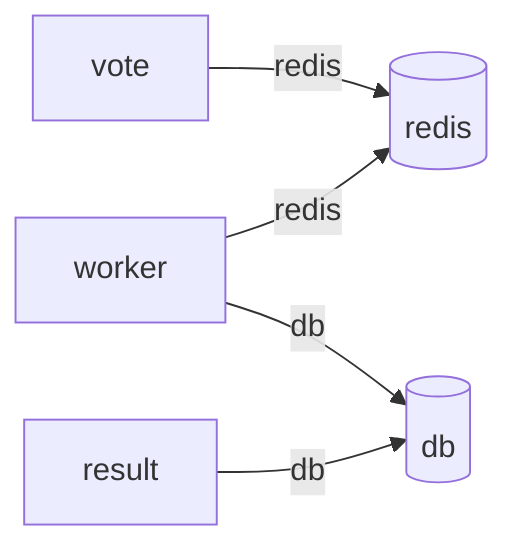
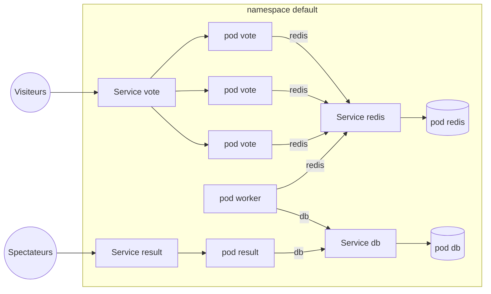

Jusqu'ici, seul `vote` tourne dans votre cluster, et cliquer sur un bouton de vote ne mène nulle part. Vous allez déployer les 4 autres morceaux de l'application (`redis`, `db`, `worker`, `result`), les relier entre eux, puis **voter pour de vrai** et suivre les résultats en direct.

Ce lab ne vous donne pas tous les fichiers complets. Les Deployments sont fournis, et vous **complétez les Services** en remplaçant des lignes `# TODO`, à partir de ce que le texte vient d'expliquer. Le bouton de vérification contrôle l'état réel du cluster, les indices se dévoilent un par un, et la solution reste en dernier recours.

**Niveau** : débutant. Vous savez déployer une application avec un Deployment, lire `kubectl get pods` et réserver des ressources : ce sont les cours [Déployer une application avec un Deployment](https://byte-layers.com/fr/skills/k8s-deployment) et [Réserver des ressources et comprendre un pod Pending](https://byte-layers.com/fr/skills/k8s-requests-pending). Le lab n'en suppose rien d'autre : chaque champ d'un Service est expliqué quand il arrive.

**Ce qu'il faut** : un cluster qui répond à `kubectl get nodes`, celui du lab [Démarrer son cluster Kubernetes](https://byte-layers.com/fr/labs/k8s-install), un éditeur de texte, un navigateur, `curl`, et les ports **28630** et **28631** de votre machine libres.

**Vos fichiers** vivent dans `~/byte-layers/kubernetes/l3`. Rien n'est supprimé à la fin : l'application complète reste en place avec ses fichiers, car les cours suivants s'en servent.

# Préparer le point de départ

## Créer le dossier et remettre vote en place

Cette étape est un **support** : elle met le cluster dans l'état de départ, et vous pouvez la jouer sans vous y arrêter. Créez d'abord le dossier de travail. `mkdir -p` crée aussi les dossiers parents qui manquent, et ne dit rien si le dossier existe déjà :

```exec
mkdir -p ~/byte-layers/kubernetes/l3
```

Écrivez ensuite le fichier du Deployment `vote` : 3 réplicas, chacun réservant un dixième de processeur et 64 Mi de mémoire.

```exec
cat > ~/byte-layers/kubernetes/l3/vote.deploy.yml <<'EOF'
# vote : 3 réplicas, chacun réservant un dixième de processeur et 64 Mi de mémoire
apiVersion: apps/v1
kind: Deployment
metadata:
  name: vote
  labels:
    app: vote
spec:
  replicas: 3
  selector:
    matchLabels:
      app: vote
  template:
    metadata:
      labels:
        app: vote
    spec:
      containers:
        - name: vote
          image: ghcr.io/bngams/kube-vote:1.0
          ports:
            - containerPort: 80
          resources:
            requests:
              cpu: 100m
              memory: 64Mi
EOF
```

> 🔍 **Comprendre la commande**
>
> | Morceau | Rôle |
> |---|---|
> | `cat` | recopie ce qu'il reçoit en entrée |
> | `> ~/byte-layers/kubernetes/l3/vote.deploy.yml` | envoie cette copie dans le fichier, qu'il crée, ou dont il remplace le contenu s'il existe déjà |
> | `<<'EOF'` | donne en entrée à `cat` toutes les lignes qui suivent, telles quelles, jusqu'à la ligne `EOF` |
> | les lignes entre les deux | le contenu du fichier |
> | `EOF` | marque la fin du contenu ; ce mot n'est pas écrit dans le fichier |

Il faut aussi le **Service** de `vote`. Un Service donne à un groupe de pods un **nom** et une **adresse** qui ne changent pas, alors que les pods, eux, changent d'adresse à chaque remplacement. Celui-ci s'appelle `vote` et sert tous les pods qui portent l'étiquette `app: vote` :

```exec
cat > ~/byte-layers/kubernetes/l3/vote.svc.yml <<'EOF'
# Une adresse stable, "vote", qui répartit les visiteurs entre tous les pods portant l'étiquette app: vote
apiVersion: v1
kind: Service
metadata:
  name: vote
  labels:
    app: vote
spec:
  selector:
    app: vote
  ports:
    - port: 80
      targetPort: 80
EOF
```

Transmettez les deux fichiers au cluster. Pour ce qui tourne déjà avec ces réglages, `kubectl apply` répond `unchanged` et ne touche à rien :

```exec
kubectl apply -f ~/byte-layers/kubernetes/l3/vote.deploy.yml -f ~/byte-layers/kubernetes/l3/vote.svc.yml
```

Attendez que les 3 pods soient prêts. `kubectl rollout status` suit le déploiement et rend la main quand il est terminé, ou au bout de 120 secondes :

```exec
kubectl rollout status deployment/vote --timeout=120s
```

```ack
vote tourne avec ses 3 réplicas et son Service
```

# La file d'attente : redis

## Cinq morceaux qui se trouvent par leur nom

L'application complète compte cinq morceaux. Le schéma montre qui appelle qui, et sous quel nom.



`vote` dépose chaque vote dans la file d'attente `redis`. `worker` les y prend et les enregistre dans la base `db`. `result` lit la base pour afficher les scores. Chaque flèche est un appel par **nom de Service** : le cluster contient un annuaire, un serveur **DNS**, qui traduit le nom d'un Service en son adresse. C'est pour cela que les noms `redis` et `db` sont imposés : ils sont écrits dans le code des applications.

Voici la même architecture, vue cette fois avec les objets Kubernetes que vous allez créer : chaque morceau a ses **pods** (fabriqués par un Deployment), précédés d'un **Service** qui leur donne un nom stable. `worker`, que personne n'appelle, n'a pas besoin de Service.



Le cadre `namespace default` désigne l'espace de rangement du cluster dans lequel vous travaillez depuis le début : c'est celui qu'on utilise quand on n'en précise aucun.

## Compléter le Service de redis

Chaque morceau a son fichier, qui contient **deux objets**, séparés par une ligne qui commence par `---` : un Deployment, fourni complet, et son Service, que vous complétez. Les champs d'un Service se lisent ainsi :

| Champ | Rôle |
|---|---|
| `kind: Service` | on décrit un Service |
| `metadata.name` | son nom, qui devient aussi son **nom d'hôte** dans le cluster : les autres pods le joignent en appelant ce nom |
| `spec.selector` | les pods à servir : tous ceux qui portent cette étiquette, maintenant et à l'avenir |
| `spec.ports[].port` | le port sur lequel le Service écoute |
| `spec.ports[].targetPort` | le port des pods vers lequel il renvoie les requêtes (le `containerPort` du Deployment) |

Créez le fichier de départ de `redis`, avec ses deux blancs. Le Deployment lance un seul pod, à partir d'une image de Redis, qui écoute sur le port 6379 :

```exec
cat > ~/byte-layers/kubernetes/l3/redis.yml <<'EOF'
# redis : la file d'attente où vote dépose les votes. Joignable dans le cluster sous le nom "redis".
apiVersion: apps/v1
kind: Deployment
metadata:
  name: redis
  labels:
    app: redis
spec:
  replicas: 1
  selector:
    matchLabels:
      app: redis
  template:
    metadata:
      labels:
        app: redis
    spec:
      containers:
        - name: redis
          image: ghcr.io/bngams/kube-redis:8-alpine
          ports:
            - containerPort: 6379
          resources:
            requests:
              cpu: 50m
              memory: 32Mi
--- # second objet du fichier : le Service de redis
apiVersion: v1
kind: Service
metadata:
  name: # TODO : le nom sous lequel vote et worker cherchent la file d'attente
  labels:
    app: redis
spec:
  selector:
    app: # TODO : l'étiquette que portent les pods du Deployment ci-dessus
  ports:
    - port: 6379
      targetPort: 6379
EOF
```

Ouvrez `~/byte-layers/kubernetes/l3/redis.yml` dans votre éditeur. Remplacez chaque `# TODO` et tout le texte qui le suit sur la ligne par la bonne valeur, puis enregistrez.

```ack
J'ai remplacé les deux TODO de redis.yml
```

## Appliquer redis.yml

Transmettez le fichier au cluster. `kubectl apply` crée les deux objets qu'il contient :

```exec
kubectl apply -f ~/byte-layers/kubernetes/l3/redis.yml
```

Le terminal doit confirmer les deux créations. Si la seconde échoue avec un message qui mentionne `name`, le nom a été laissé vide en retirant le `# TODO` : complétez-le, enregistrez, et relancez la commande.

```text
deployment.apps/redis created
service/redis created
```

Attendez que le pod de `redis` soit prêt. Le premier téléchargement de l'image peut prendre une minute :

```exec
kubectl rollout status deployment/redis --timeout=120s
```

Demandez ensuite au Service à quel pod il transmet les requêtes :

```exec
kubectl describe service redis
```

Parmi les lignes affichées, la ligne `Endpoints` doit donner l'adresse d'un pod, celui de `redis`. Si elle affiche `<none>`, le `selector` ne correspond à aucun pod.

```text
Selector:                 app=redis
Endpoints:                10.244.218.75:6379
```

```hint
Le nom imposé est écrit sur les flèches du premier schéma, et dans le commentaire en tête du fichier.
```

```hint
L'étiquette des pods se lit dans le Deployment, sous `template.metadata.labels` : `app: redis`. Chaque valeur s'écrit après les deux-points et une espace, à la place du `# TODO`.
```

```verify
if ! kubectl get service redis >/dev/null 2>&1; then
  echo "Il n'y a pas de Service redis. Remplacez les TODO de redis.yml, puis lancez kubectl apply -f ~/byte-layers/kubernetes/l3/redis.yml et lisez sa réponse."
  exit 1
fi
SEL=$(kubectl get service redis -o jsonpath='{.spec.selector.app}')
if [ "$SEL" != "redis" ]; then
  echo "Le selector du Service redis est « app: ${SEL:-vide} » : il doit désigner l'étiquette app: redis des pods."
  exit 1
fi
if ! kubectl rollout status deployment/redis --timeout=40s >/dev/null 2>&1; then
  echo "Le pod de redis n'est pas prêt. Regardez kubectl get pods, puis réessayez."
  exit 1
fi
HAVE=$(kubectl get endpointslices -l kubernetes.io/service-name=redis -o jsonpath='{range .items[*].endpoints[*]}{.addresses[0]}{"\n"}{end}' | grep -c .)
if [ "$HAVE" -lt 1 ]; then
  echo "Le Service redis ne sert aucun pod : sa ligne Endpoints est vide. Vérifiez son selector."
  exit 1
fi
echo "redis tourne, et son Service lui transmet les requêtes."
```

````solution
Le fichier complet, écrit par une commande, puis appliqué :

```bash
cat > ~/byte-layers/kubernetes/l3/redis.yml <<'EOF'
# redis : la file d'attente où vote dépose les votes. Joignable dans le cluster sous le nom "redis".
apiVersion: apps/v1
kind: Deployment
metadata:
  name: redis
  labels:
    app: redis
spec:
  replicas: 1
  selector:
    matchLabels:
      app: redis
  template:
    metadata:
      labels:
        app: redis
    spec:
      containers:
        - name: redis
          image: ghcr.io/bngams/kube-redis:8-alpine
          ports:
            - containerPort: 6379
          resources:
            requests:
              cpu: 50m
              memory: 32Mi
--- # second objet du fichier : le Service de redis
apiVersion: v1
kind: Service
metadata:
  name: redis
  labels:
    app: redis
spec:
  selector:
    app: redis
  ports:
    - port: 6379
      targetPort: 6379
EOF
kubectl apply -f ~/byte-layers/kubernetes/l3/redis.yml
kubectl rollout status deployment/redis --timeout=50s
```
````

# La base et celui qui la remplit : db et worker

## Compléter le Service de db

`db` est la base de données PostgreSQL qui garde les votes. Son fichier a la même forme que celui de `redis`, avec deux différences. Le Deployment passe à l'image deux **variables d'environnement**, des réglages donnés au conteneur à son démarrage : le nom et le mot de passe de l'administrateur de la base. Et le Service a cette fois quatre blancs, dont les ports : PostgreSQL écoute sur le port 5432, et c'est sur ce même port que `worker` et `result` appellent le nom `db`.

```exec
cat > ~/byte-layers/kubernetes/l3/db.yml <<'EOF'
# db : la base PostgreSQL qui garde les votes. Joignable dans le cluster sous le nom "db".
# Les identifiants sont écrits en clair : un raccourci assumé, à ne pas reproduire. Leur place est dans un Secret.
apiVersion: apps/v1
kind: Deployment
metadata:
  name: db
  labels:
    app: db
spec:
  replicas: 1
  selector:
    matchLabels:
      app: db
  template:
    metadata:
      labels:
        app: db
    spec:
      containers:
        - name: postgres
          image: ghcr.io/bngams/kube-postgres:15-alpine
          env:
            - name: POSTGRES_USER
              value: postgres
            - name: POSTGRES_PASSWORD
              value: postgres
          ports:
            - containerPort: 5432
          resources:
            requests:
              cpu: 100m
              memory: 128Mi
--- # second objet du fichier : le Service de db
apiVersion: v1
kind: Service
metadata:
  name: # TODO : le nom sous lequel worker et result cherchent la base
  labels:
    app: db
spec:
  selector:
    app: # TODO : l'étiquette des pods de la base
  ports:
    - port: # TODO : le port sur lequel le Service écoute
      targetPort: # TODO : le port du conteneur vers lequel il renvoie
EOF
```

Ouvrez `~/byte-layers/kubernetes/l3/db.yml` dans votre éditeur, remplacez les quatre `# TODO`, puis enregistrez.

> ⚖️ **Un raccourci assumé.** Ce fichier contient le mot de passe de la base **en clair** (`postgres`). C'est une mauvaise pratique, gardée volontairement pour l'instant : un prochain cours le range dans un **Secret**. Autre simplification : la base ne garde pas ses données si son pod est remplacé. En production, on lui donnerait un **volume persistant**.

```ack
J'ai remplacé les quatre TODO de db.yml
```

## Écrire le fichier de worker, qui n'a pas de Service

`worker` sort les votes de `redis` et les enregistre dans `db`. Il appelle les autres, mais personne ne l'appelle : il n'a donc pas besoin de Service, et son fichier ne contient qu'un Deployment, fourni complet.

```exec
cat > ~/byte-layers/kubernetes/l3/worker.yml <<'EOF'
# worker : sort les votes de redis et les enregistre dans db. Personne ne l'appelle : pas de Service.
apiVersion: apps/v1
kind: Deployment
metadata:
  name: worker
  labels:
    app: worker
spec:
  replicas: 1
  selector:
    matchLabels:
      app: worker
  template:
    metadata:
      labels:
        app: worker
    spec:
      containers:
        - name: worker
          image: ghcr.io/bngams/kube-worker:1.0
          resources:
            requests:
              cpu: 50m
              memory: 64Mi
EOF
```

```ack
J'ai écrit worker.yml
```

## Appliquer db et worker, puis lire les logs de worker

Transmettez les deux fichiers au cluster :

```exec
kubectl apply -f ~/byte-layers/kubernetes/l3/db.yml -f ~/byte-layers/kubernetes/l3/worker.yml
```

Attendez que la base soit prête, puis `worker` :

```exec
kubectl rollout status deployment/db --timeout=120s
kubectl rollout status deployment/worker --timeout=120s
```

`worker` a-t-il trouvé `redis` et `db` ? Il le dit dans ses **logs**, le journal de ce qu'il écrit. `kubectl logs deployment/worker` les affiche :

```exec
kubectl logs deployment/worker
```

Vous devez y lire qu'il a joint la base, puis la file d'attente, dont il affiche l'adresse : celle du Service `redis`, obtenue à partir de son nom. La ligne `Waiting for db` apparaît quand `worker` a démarré avant que la base soit prête : il a simplement réessayé.

```text
Waiting for db
Connected to db
Found redis at 10.103.55.195
Connecting to redis
```

```hint
Le nom imposé pour la base est écrit sur les flèches du premier schéma : `db`. L'étiquette des pods se lit dans le Deployment, comme pour `redis`.
```

```hint
PostgreSQL écoute sur le port 5432 : c'est le `containerPort` du Deployment, donc le `targetPort` du Service. Les applications appellent `db` sur ce même port, donc `port` vaut aussi 5432.
```

```verify
if ! kubectl get service db >/dev/null 2>&1; then
  echo "Il n'y a pas de Service db. Remplacez les TODO de db.yml, puis lancez la commande kubectl apply de cette section et lisez sa réponse."
  exit 1
fi
SEL=$(kubectl get service db -o jsonpath='{.spec.selector.app}')
if [ "$SEL" != "db" ]; then
  echo "Le selector du Service db est « app: ${SEL:-vide} » : il doit désigner l'étiquette app: db des pods."
  exit 1
fi
PORT=$(kubectl get service db -o jsonpath='{.spec.ports[0].port}')
TARGET=$(kubectl get service db -o jsonpath='{.spec.ports[0].targetPort}')
if [ "$PORT" != "5432" ] || [ "$TARGET" != "5432" ]; then
  echo "Le Service db écoute sur le port ${PORT:-?} et renvoie vers le port ${TARGET:-?} : il faut 5432 et 5432."
  exit 1
fi
if ! kubectl rollout status deployment/db --timeout=30s >/dev/null 2>&1; then
  echo "Le pod de db n'est pas prêt. Regardez kubectl get pods, puis réessayez."
  exit 1
fi
if ! kubectl get deployment worker >/dev/null 2>&1; then
  echo "Le Deployment worker n'existe pas. Lancez la commande kubectl apply de cette section."
  exit 1
fi
ok=0
for i in 1 2 3 4 5 6 7 8 9 10; do
  if kubectl logs deployment/worker 2>/dev/null | grep -q 'Connected to db'; then ok=1; break; fi
  sleep 2
done
if [ "$ok" != 1 ]; then
  echo "worker n'a pas encore joint la base par le nom db. Attendez quelques secondes et réessayez, ou lisez : kubectl logs deployment/worker"
  exit 1
fi
echo "db tourne derrière son Service, et worker l'a trouvée par son nom."
```

````solution
Le fichier `db.yml` complet, écrit par une commande, puis appliqué avec `worker.yml` :

```bash
cat > ~/byte-layers/kubernetes/l3/db.yml <<'EOF'
# db : la base PostgreSQL qui garde les votes. Joignable dans le cluster sous le nom "db".
# Les identifiants sont écrits en clair : un raccourci assumé, à ne pas reproduire. Leur place est dans un Secret.
apiVersion: apps/v1
kind: Deployment
metadata:
  name: db
  labels:
    app: db
spec:
  replicas: 1
  selector:
    matchLabels:
      app: db
  template:
    metadata:
      labels:
        app: db
    spec:
      containers:
        - name: postgres
          image: ghcr.io/bngams/kube-postgres:15-alpine
          env:
            - name: POSTGRES_USER
              value: postgres
            - name: POSTGRES_PASSWORD
              value: postgres
          ports:
            - containerPort: 5432
          resources:
            requests:
              cpu: 100m
              memory: 128Mi
--- # second objet du fichier : le Service de db
apiVersion: v1
kind: Service
metadata:
  name: db
  labels:
    app: db
spec:
  selector:
    app: db
  ports:
    - port: 5432
      targetPort: 5432
EOF
kubectl apply -f ~/byte-layers/kubernetes/l3/db.yml -f ~/byte-layers/kubernetes/l3/worker.yml
kubectl rollout status deployment/db --timeout=50s
```
````

# La page des résultats : result

## Écrire le Service de result en entier

`result` est la page qui affiche les scores en direct : elle lit la base `db`. Comme `vote`, c'est un site web, qui écoute sur le port 80 de son conteneur, et il lui faut un Service pour qu'on puisse la joindre.

Aux étapes précédentes, vous avez complété des Services à trous. Celui-ci, vous l'écrivez en entier, sur le modèle de `redis.yml` et de `db.yml` : mêmes champs, mêmes décalages. Créez le fichier de départ, où le Deployment est fourni :

```exec
cat > ~/byte-layers/kubernetes/l3/result.yml <<'EOF'
# result : la page des résultats en direct, qui lit db. Joignable dans le cluster sous le nom "result".
apiVersion: apps/v1
kind: Deployment
metadata:
  name: result
  labels:
    app: result
spec:
  replicas: 1
  selector:
    matchLabels:
      app: result
  template:
    metadata:
      labels:
        app: result
    spec:
      containers:
        - name: result
          image: ghcr.io/bngams/kube-result:1.0
          ports:
            - containerPort: 80
          resources:
            requests:
              cpu: 50m
              memory: 64Mi
--- # second objet du fichier : le Service de result
# TODO : le Service result, qui écoute sur le port 80 et renvoie vers le port 80 des pods portant l'étiquette app: result
EOF
```

Ouvrez `~/byte-layers/kubernetes/l3/result.yml` dans votre éditeur et remplacez la ligne `# TODO` par le Service complet, puis enregistrez.

```ack
J'ai écrit le Service dans result.yml
```

## Appliquer result.yml et faire le tour des cinq morceaux

Transmettez le fichier au cluster, puis attendez que le pod soit prêt :

```exec
kubectl apply -f ~/byte-layers/kubernetes/l3/result.yml
kubectl rollout status deployment/result --timeout=120s
```

Les cinq morceaux sont maintenant déployés. Listez les pods :

```exec
kubectl get pods
```

Tous doivent être `Running`, avec `1/1` dans la colonne `READY` :

```text
NAME                      READY   STATUS    RESTARTS   AGE
db-58c6c6b486-ldlxp       1/1     Running   0          2m
redis-5b95d4d69f-k6t65    1/1     Running   0          5m
result-656b779d76-mv975   1/1     Running   0          10s
vote-fc57495c-bkvsf       1/1     Running   0          12m
vote-fc57495c-sjkxq       1/1     Running   0          12m
vote-fc57495c-smqsr       1/1     Running   0          12m
worker-7b7bc56f88-j9pwh   1/1     Running   0          2m
```

> 💡 **`worker` ou `result` affichent des redémarrages (`RESTARTS 1`) ?** Pas d'inquiétude : s'ils ont perdu le contact avec la base pendant son démarrage, ils ont planté, Kubernetes les a relancés, et ils ont fini par la trouver. Les morceaux d'une application n'ont pas besoin de démarrer dans un ordre précis : la réconciliation finit par tout remettre d'aplomb.

Listez enfin les Services :

```exec
kubectl get services
```

Chacun a reçu son adresse fixe dans la colonne `CLUSTER-IP`. Le type `ClusterIP` signifie qu'elle n'est joignable qu'à l'intérieur du cluster. Le Service `kubernetes` existait déjà : c'est celui de Kubernetes lui-même, n'y touchez pas.

```text
NAME         TYPE        CLUSTER-IP       EXTERNAL-IP   PORT(S)    AGE
db           ClusterIP   10.101.249.152   <none>        5432/TCP   2m
kubernetes   ClusterIP   10.96.0.1        <none>        443/TCP    2h
redis        ClusterIP   10.103.55.195    <none>        6379/TCP   5m
result       ClusterIP   10.99.82.197     <none>        80/TCP     10s
vote         ClusterIP   10.107.207.113   <none>        80/TCP     12m
```

```hint
Un Service commence par `apiVersion: v1` et `kind: Service`. Viennent ensuite `metadata.name`, puis `spec` avec son `selector` et ses `ports` : recopiez la forme du Service de `redis.yml`, en changeant le nom, l'étiquette et les deux ports.
```

```hint
Le nom est `result`, le selector est `app: result`, et `port` comme `targetPort` valent 80.
```

```verify
if ! kubectl get service result >/dev/null 2>&1; then
  echo "Il n'y a pas de Service result. Écrivez-le dans result.yml à la place du TODO, puis lancez kubectl apply -f ~/byte-layers/kubernetes/l3/result.yml et lisez sa réponse."
  exit 1
fi
SEL=$(kubectl get service result -o jsonpath='{.spec.selector.app}')
if [ "$SEL" != "result" ]; then
  echo "Le selector du Service result est « app: ${SEL:-vide} » : il doit désigner l'étiquette app: result des pods."
  exit 1
fi
PORT=$(kubectl get service result -o jsonpath='{.spec.ports[0].port}')
TARGET=$(kubectl get service result -o jsonpath='{.spec.ports[0].targetPort}')
if [ "$PORT" != "80" ] || [ "$TARGET" != "80" ]; then
  echo "Le Service result écoute sur le port ${PORT:-?} et renvoie vers le port ${TARGET:-?} : il faut 80 et 80."
  exit 1
fi
for d in vote redis db worker result; do
  if ! kubectl rollout status deployment/$d --timeout=20s >/dev/null 2>&1; then
    echo "Le Deployment $d n'est pas prêt, ou n'existe pas. Regardez kubectl get pods, et reprenez l'étape qui le déploie."
    exit 1
  fi
done
HAVE=$(kubectl get endpointslices -l kubernetes.io/service-name=result -o jsonpath='{range .items[*].endpoints[*]}{.addresses[0]}{"\n"}{end}' | grep -c .)
if [ "$HAVE" -lt 1 ]; then
  echo "Le Service result ne sert aucun pod : sa ligne Endpoints est vide. Vérifiez son selector."
  exit 1
fi
echo "Les cinq morceaux tournent, et result a son Service."
```

````solution
Le fichier complet, écrit par une commande, puis appliqué :

```bash
cat > ~/byte-layers/kubernetes/l3/result.yml <<'EOF'
# result : la page des résultats en direct, qui lit db. Joignable dans le cluster sous le nom "result".
apiVersion: apps/v1
kind: Deployment
metadata:
  name: result
  labels:
    app: result
spec:
  replicas: 1
  selector:
    matchLabels:
      app: result
  template:
    metadata:
      labels:
        app: result
    spec:
      containers:
        - name: result
          image: ghcr.io/bngams/kube-result:1.0
          ports:
            - containerPort: 80
          resources:
            requests:
              cpu: 50m
              memory: 64Mi
--- # second objet du fichier : le Service de result
apiVersion: v1
kind: Service
metadata:
  name: result
  labels:
    app: result
spec:
  selector:
    app: result
  ports:
    - port: 80
      targetPort: 80
EOF
kubectl apply -f ~/byte-layers/kubernetes/l3/result.yml
kubectl rollout status deployment/result --timeout=50s
```
````

# Voter pour de vrai

## Ouvrir un tunnel vers chaque page

Toute la chaîne est en place : on peut enfin voter. Pour l'instant, les Services ne sont joignables que de l'intérieur du cluster. Vous ouvrez donc deux tunnels avec `kubectl port-forward`, un par page, vers les **Services**. Le premier relie le port 28630 de votre machine au port 80 du Service `vote` :

```exec
kubectl port-forward service/vote 28630:80 > /dev/null 2>&1 &
```

> 🔍 **Comprendre la commande**
>
> | Morceau | Rôle |
> |---|---|
> | `kubectl port-forward service/vote` | ouvre un tunnel entre votre machine et le Service `vote` |
> | `28630:80` | le port 28630 de votre machine mène au port 80 du Service |
> | `> /dev/null` | jette ce que la commande affiche, pour ne pas encombrer le terminal |
> | `2>&1` | jette aussi ses messages d'erreur, au même endroit |
> | `&` | lance la commande en arrière-plan : le terminal vous rend la main, et le tunnel reste ouvert |

Le terminal affiche un numéro de tâche, du type `[1] 12345`, et vous rend la main. Le second tunnel relie le port 28631 à la page des résultats :

```exec
kubectl port-forward service/result 28631:80 > /dev/null 2>&1 &
```

Ouvrez les deux pages dans votre navigateur, côte à côte si possible. Si une page répond « connexion refusée », le tunnel n'a pas fini de s'ouvrir : rechargez-la une seconde plus tard. Sur un poste hébergé (un VS Code dans le navigateur, fourni par un formateur), passez par l'onglet **PORTS** de VS Code, qui donne l'adresse de chaque port.

| Page | Adresse sur votre poste |
|---|---|
| Vote | `http://localhost:28630` |
| Résultats | `http://localhost:28631` |

```ack
Les deux pages s'affichent
```

## Voter et suivre le résultat en direct

**Votez !** Cliquez sur « Chats » ou « Chiens » : une coche ✓ confirme votre vote, et la page des résultats se met à jour **en direct**. La page des résultats, qui n'a pas été traduite, affiche « Cats » et « Dogs » : ce sont les mêmes deux choix. Chaque navigateur compte pour un votant, qui peut changer d'avis.

> 🧠 **Ce qui vient de se passer.** Votre clic a traversé tout le cluster : `vote` a déposé le vote dans `redis`, `worker` l'a sorti de la file et enregistré dans `db`, et `result` l'a lu dans la base pour l'afficher. Cinq programmes, écrits dans trois langages (Python, .NET, Node.js) auxquels s'ajoutent Redis et PostgreSQL, qui coopèrent uniquement grâce aux **noms de Services**.

Suivez votre vote à la trace. Les logs de `worker` gardent une ligne par vote traité, et `--tail=3` n'affiche que les 3 dernières lignes :

```exec
kubectl logs deployment/worker --tail=3
```

La dernière ligne est celle de votre vote : `a` pour « Chats », `b` pour « Chiens », suivi de l'identifiant de votre navigateur.

```text
Found redis at 10.103.55.195
Connecting to redis
Processing vote for 'a' by '14c8b06fb9ebe03'
```

Le vote est aussi dans la base. `kubectl exec` lance une commande **dans** un conteneur qui tourne, ici le client `psql` de PostgreSQL. `--` sépare les options de `kubectl` de la commande lancée dans le conteneur, `-U` donne l'utilisateur à `psql`, et `-c` la requête : compter les votes par option.

```exec
kubectl exec deployment/db -- psql -U postgres -c "select vote, count(*) from votes group by vote"
```

La base répond par un petit tableau, une ligne par option qui a reçu des votes :

```text
 vote | count 
------+-------
 a    |     1
(1 row)
```

```hint
Le vote se fait dans le navigateur, sur la page `http://localhost:28630`. Si elle ne s'affiche pas, relancez la commande du tunnel de la section précédente.
```

```verify
for d in vote redis db worker result; do
  if ! kubectl get deployment $d >/dev/null 2>&1; then
    echo "Le Deployment $d n'existe pas : reprenez l'étape qui le déploie."
    exit 1
  fi
done
N=0
for i in 1 2 3 4 5; do
  N=$(kubectl exec deployment/db -- psql -U postgres -tAc "select count(*) from votes" 2>/dev/null)
  case "$N" in ''|0) sleep 2 ;; *) break ;; esac
done
case "$N" in
  ''|0) echo "Aucun vote n'est encore arrivé dans la base. Votez sur http://localhost:28630, puis réessayez. Si le vote ne part pas, lisez : kubectl logs deployment/worker"
        exit 1 ;;
esac
echo "$N vote(s) dans la base : votre clic a traversé vote, redis, worker et db."
```

````solution
Le vote se fait d'un clic dans le navigateur. Cette commande fait la même chose sans navigateur : elle envoie à la page de vote, par le tunnel, le formulaire que le bouton « Chats » enverrait.

```bash
curl -s -o /dev/null -d "vote=a" http://localhost:28630/
sleep 3
```
````

## Un tunnel ne sert qu'un seul pod

Rechargez maintenant plusieurs fois la page de **vote**, en regardant la ligne « Servi par » : c'est **toujours le même pod**, alors que `vote` a 3 réplicas. Un `port-forward`, même vers un Service, choisit un seul pod au démarrage. C'est un outil de test : pour que des visiteurs voient la charge se répartir, il faut une vraie porte d'entrée vers le cluster, et c'est le rôle d'un autre objet, l'Ingress.

```ack
J'ai vu le même pod servir toutes mes visites
```

## Arrêter les tunnels

Les deux tunnels tournent encore en arrière-plan. `pkill -f` arrête les programmes dont la ligne de commande contient le texte donné, ici chacun de vos deux tunnels :

```exec
pkill -f "port-forward service/vote 28630"
pkill -f "port-forward service/result 28631"
```

Les deux pages ne répondent plus, et c'est normal. L'application, elle, continue de tourner dans le cluster : laissez-la en place, les cours suivants s'en servent.

## Récap

- Les morceaux d'une application se trouvent par **nom de Service**, grâce au DNS du cluster : `vote` et `worker` appellent `redis`, `worker` et `result` appellent `db`.
- Un fichier peut contenir plusieurs objets, séparés par une ligne `---` : ici un Deployment et son Service.
- Un morceau que personne n'appelle, comme `worker`, n'a pas besoin de Service.
- Les morceaux n'ont pas à démarrer dans un ordre précis : un pod qui plante faute de base est relancé, et finit par la trouver.
- `kubectl port-forward` ouvre un tunnel de test vers un seul pod ; ce n'est pas une façon d'exposer une application.

Les fichiers finaux se trouvent dans le dossier `solution/` de ce lab : [`redis.yml`](../solution/redis.yml), [`db.yml`](../solution/db.yml), [`worker.yml`](../solution/worker.yml) et [`result.yml`](../solution/result.yml), avec [`vote.deploy.yml`](../solution/vote.deploy.yml) et [`vote.svc.yml`](../solution/vote.svc.yml).

> 📖 [Les Services, documentation officielle](https://kubernetes.io/fr/docs/concepts/services-networking/service/) · [`kubectl port-forward`](https://kubernetes.io/docs/reference/kubectl/generated/kubectl_port-forward/) (en anglais) · [L'application d'origine, example-voting-app](https://github.com/dockersamples/example-voting-app) (en anglais)
