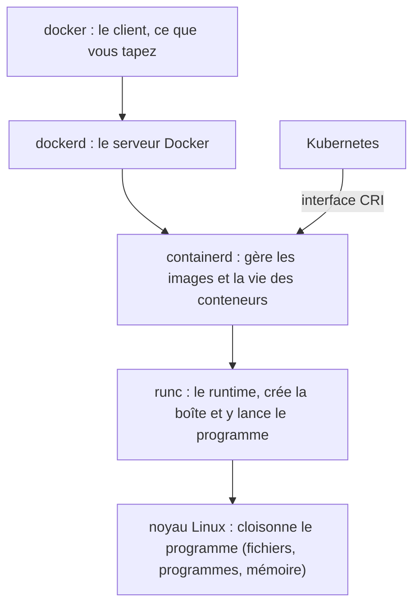

Avant Kubernetes, il faut avoir en main ce qu'il fait tourner : des **conteneurs**. Vous allez lancer l'application de vote de tout le parcours dans un conteneur, en faire tourner deux versions côte à côte, construire votre propre image, puis la faire planter, pour voir de vos yeux pourquoi on a besoin d'un orchestrateur.

**Niveau** : débutant. Ce lab est un échauffement, il ne réenseigne pas Docker. Si vous connaissez déjà les conteneurs, lisez-le vite, sans tout exécuter, et cochez vous-même les étapes : il sert surtout à prendre en main l'application que vous déploierez ensuite sur Kubernetes. Si une commande vous est inconnue, le détail est dans les cours du parcours Docker : [Lancer, configurer et observer un conteneur](https://byte-layers.com/fr/skills/docker-run) et [Écrire le Dockerfile d'une application](https://byte-layers.com/fr/skills/docker-dockerfile).

**Ce qu'il faut** : Docker qui répond à `docker ps` (le lab [Installer Docker et vérifier son poste](https://byte-layers.com/fr/labs/docker-install) vous y amène), `curl`, une commande qui demande une page web depuis le terminal, un navigateur, et les ports **28600** et **28601** libres. Sur un poste hébergé, c'est-à-dire un VS Code ouvert dans votre navigateur et fourni par un formateur, Docker est déjà prêt.

**Ce que le lab crée** : trois conteneurs et une image, tous préfixés par `layers-k8s-l0-`. Aucun fichier n'est écrit sur votre machine. La dernière étape supprime les conteneurs et l'image construite.

> ⚠️ **Si vous avez déjà un cluster Kubernetes sur ce poste**, il tourne lui-même dans des conteneurs : `layers-k8s` avec minikube, `k3d-layers-k8s-…` sur un poste hébergé. Vous les verrez dans `docker ps`. **N'y touchez jamais** : les supprimer détruirait votre cluster.

# Lancer l'application de vote dans un conteneur

## Vérifier que Docker répond

Tout se fait dans un terminal, par exemple celui de VS Code, menu **Terminal > Nouveau terminal**. Demandez d'abord sa version à Docker :

```exec
docker version
```

Vous devez voir deux blocs, `Client` et `Server`. Si le bloc `Server` affiche une erreur, le moteur Docker n'est pas démarré : avec Docker Desktop, lancez l'application et attendez qu'elle indique que le moteur tourne.

> 🧠 **Pourquoi deux blocs ?** La commande `docker` que vous tapez est un simple **client** : elle transmet vos demandes à un **serveur**, le moteur Docker, qui fait le vrai travail. On appellera ce serveur la **machine Docker** : c'est votre poste, ou votre session sur un poste hébergé.

## Lancer un premier conteneur

Une **image** est un paquet qui contient une application **et tout ce dont elle a besoin pour tourner** : le langage (ici Python), les bibliothèques, la configuration. Elle est rangée dans un **registre**, une sorte de bibliothèque d'images en ligne. Un **conteneur**, c'est une image **en train de tourner**.

Pour joindre l'application depuis le navigateur, on utilise un **port** : un numéro de « porte » sur une machine, derrière lequel une application attend les visiteurs. Un site web classique attend sur la porte 80.

Lancez l'application de vote dans un conteneur :

```exec
docker run -d --name layers-k8s-l0-vote -p 28600:80 ghcr.io/bngams/kube-vote:1.0
```

| Élément | Rôle |
|---|---|
| `docker run` | crée un conteneur à partir d'une image et le démarre |
| `-d` | en arrière-plan (*detached*) : la commande rend la main tout de suite |
| `--name layers-k8s-l0-vote` | le nom qu'on donne au conteneur, pour le retrouver facilement |
| `-p 28600:80` | relie la porte **28600 de la machine Docker** à la porte **80 du conteneur**, celle où l'application attend |
| `ghcr.io/bngams/kube-vote:1.0` | l'image : `ghcr.io` est l'adresse du registre, `bngams` le compte qui y publie l'image, `kube-vote` le nom de l'image, `1.0` sa **version** (on dit aussi son *tag*) |

Si l'image n'est pas encore sur la machine Docker, celle-ci la télécharge d'abord. Le terminal affiche alors quelques lignes de progression, puis un long identifiant, celui du conteneur :

```text
Unable to find image 'ghcr.io/bngams/kube-vote:1.0' locally
1.0: Pulling from bngams/kube-vote
...
Status: Downloaded newer image for ghcr.io/bngams/kube-vote:1.0
1ae72b5530a53b468540d75fbce72810a8f33d2a3e16145075ebb91f63e8b824
```

Ouvrez `http://localhost:28600` dans votre navigateur. Sur un poste hébergé, passez par l'onglet **PORTS** de VS Code, qui donne le lien de ce port.

Vous devez voir la page « Chats ou Chiens ? » avec un badge **v1.0** en haut à droite. **Ne cliquez pas sur les boutons** : l'application n'est pas complète, le vote déclencherait une erreur. En bas, la ligne « Servi par : **1ae72b5530a5** » affiche un identifiant. Le vôtre sera différent : gardez-le en tête pour la section suivante.

> 🧠 **Ce qui vient de se passer.** Vous n'avez installé ni Python ni aucune bibliothèque, et l'application tourne pourtant. Tout était **dans l'image**. C'est la promesse des conteneurs : la même image tourne de la même façon sur le poste d'un développeur, sur un serveur de test ou en production. Le fameux « *ça marche sur ma machine* » devient beaucoup plus rare.

> ⚠️ **Symptôme :** `Conflict. The container name "/layers-k8s-l0-vote" is already in use`.
> **Cause :** un conteneur portant ce nom existe déjà, par exemple parce que la commande a déjà été lancée une fois.
> **Correctif :** supprimez l'ancien avec `docker rm -f layers-k8s-l0-vote`, puis relancez la commande. Ce correctif vaut pour tous les noms de ce lab.

## Retrouver son conteneur dans la liste, puis lire son journal

Demandez à Docker la liste des conteneurs qui tournent. Avant de valider, faites une prévision : l'identifiant affiché en bas de la page web va-t-il s'y trouver ?

```exec
docker ps
```

Le terminal affiche un tableau. Voici celui obtenu sur un poste où le cluster minikube tourne déjà :

```text
CONTAINER ID   IMAGE                                 COMMAND                  CREATED          STATUS          PORTS                                       NAMES
1ae72b5530a5   ghcr.io/bngams/kube-vote:1.0          "gunicorn app:app -b…"   4 seconds ago    Up 3 seconds    0.0.0.0:28600->80/tcp, [::]:28600->80/tcp   layers-k8s-l0-vote
e9438655bb00   gcr.io/k8s-minikube/kicbase:v0.0.48   "/usr/local/bin/entr…"   17 minutes ago   Up 15 minutes   127.0.0.1:52007->22/tcp, …                  layers-k8s
```

La première ligne est votre conteneur. Ses colonnes se lisent ainsi :

| Colonne | Ce qu'elle dit |
|---|---|
| `CONTAINER ID` | l'identifiant du conteneur. **C'est celui affiché en bas de la page web** : l'application affiche le nom de la « machine » qui la fait tourner, et pour elle, cette machine, c'est le conteneur |
| `IMAGE` | l'image à partir de laquelle il a été créé |
| `COMMAND` | le programme lancé dans le conteneur (ici `gunicorn`, le serveur web de l'application) |
| `CREATED` / `STATUS` | quand il a été créé ; `Up` indique qu'il tourne, et depuis combien de temps |
| `PORTS` | le branchement de la porte 28600 vers la porte 80 demandé avec `-p` (`0.0.0.0` et `[::]` signifient « accessible depuis toutes les adresses de la machine ») |
| `NAMES` | le nom donné avec `--name` |

> 🛑 **Et les autres lignes ?** Ce sont vos autres conteneurs. Si l'un d'eux s'appelle `layers-k8s` ou `k3d-layers-k8s-…`, c'est **votre cluster Kubernetes**. Eh oui, un cluster d'apprentissage tourne lui-même dans des conteneurs ! Dans la suite du lab, ignorez simplement ces lignes : toutes les commandes ne visent que des noms en `layers-k8s-l0-`.

Regardez maintenant ce que l'application raconte, c'est-à-dire son **journal** (*logs*) :

```exec
docker logs layers-k8s-l0-vote
```

Le terminal affiche les messages de démarrage, puis une ligne par page demandée. La fin de cette ligne nomme le programme qui a demandé la page : votre navigateur, ou comme ici `curl`, quand la page est demandée depuis le terminal.

```text
[2026-11-19 00:06:53 +0000] [1] [INFO] Starting gunicorn 26.2.0
...
[2026-11-19 00:06:53 +0000] [8] [INFO] Démarrage de vote version 1.0 sur 1ae72b5530a5
140.82.121.4 - - [19/Nov/2026:00:06:55 +0000] "GET / HTTP/1.1" 200 1020 "-" "curl/8.7.1"
```

> 🗣️ **En réunion projet.** « *Tu peux regarder les logs ?* » est souvent la première question posée lors d'un incident. Les logs sont le premier endroit où une application explique ce qui ne va pas.

```verify
C=layers-k8s-l0-vote
if ! docker info >/dev/null 2>&1; then
  echo "Docker ne répond pas. Démarrez-le, puis réessayez."
  exit 1
fi
if [ "$(docker container inspect "$C" --format '{{.State.Running}}' 2>/dev/null)" != "true" ]; then
  echo "Le conteneur $C ne tourne pas. Pour repartir de zéro : docker rm -f $C, puis relancez la commande docker run de cette étape."
  exit 1
fi
case "$(docker container inspect "$C" --format '{{.Config.Image}}')" in
  *kube-vote:1.0*) : ;;
  *) echo "$C ne vient pas de l'image ghcr.io/bngams/kube-vote:1.0. Supprimez-le avec docker rm -f $C, puis relancez la commande de cette étape."; exit 1 ;;
esac
ok=0
for i in 1 2 3 4 5; do
  if curl -s --max-time 5 http://localhost:28600 | grep -q 'v1.0'; then ok=1; break; fi
  sleep 1
done
if [ "$ok" != 1 ]; then
  echo "La page de vote ne répond pas sur le port 28600. Regardez la colonne PORTS de docker ps : elle doit relier 28600 à 80."
  exit 1
fi
echo "L'application de vote v1.0 tourne dans $C et répond sur le port 28600."
```

# Deux versions côte à côte, puis votre propre image

## Lancer la version 2.0 avec d'autres réglages

Lancez maintenant la **version 2.0** de la même application, **en même temps** que la première. Elle ne peut pas utiliser la porte 28600, déjà prise : on la branche sur la **28601**. On en profite pour changer la question du vote, sans toucher à l'application, grâce à des **variables d'environnement** (`-e`) :

```exec
docker run -d --name layers-k8s-l0-vote-v2 -p 28601:80 -e OPTION_A=Thé -e OPTION_B=Café ghcr.io/bngams/kube-vote:2.0
```

| Élément | Rôle |
|---|---|
| `--name layers-k8s-l0-vote-v2` | un autre nom : deux conteneurs ne peuvent pas porter le même |
| `-p 28601:80` | une autre porte côté machine Docker. Dans le conteneur, l'application attend toujours sur la porte 80, sans conflit avec la première : chaque conteneur a ses propres portes |
| `-e OPTION_A=Thé -e OPTION_B=Café` | des réglages transmis à l'application au démarrage. Celle-ci est prévue pour lire `OPTION_A` et `OPTION_B` |
| `:2.0` | la version 2.0 de l'image |

Une image est faite de **couches** (*layers*) empilées. Les quatre premières de la version 2.0, le système et Python, sont identiques à celles de la version 1.0 : la machine Docker les a **déjà**, elle ne télécharge que ce qui change. C'est pour cela qu'une mise à jour est souvent bien plus rapide que la première installation. Le bit [Couches et copy-on-write](https://byte-layers.com/fr/bits/image-layers) le montre en détail.

Ouvrez la version 2.0 dans un nouvel onglet, à l'adresse `http://localhost:28601`, ou par l'onglet **PORTS** sur un poste hébergé. Vous voyez « **Thé ou Café ?** », avec un nouveau design et un badge **v2.0**. Dans l'autre onglet, la version 1.0 tourne toujours.

> 🧠 **Ce qui vient de se passer.** Deux versions de la même application tournent **sur la même machine**, chacune dans sa boîte, sans se gêner. Et la seconde a été **configurée sans être modifiée** : la même image peut servir en test, en préproduction et en production, avec des réglages différents. Vous retrouverez cette idée dans un prochain cours, avec les ConfigMaps de Kubernetes.

## Lire la recette d'une image : le Dockerfile

Une image est fabriquée à partir d'un fichier texte, le **Dockerfile**, qui décrit les étapes de sa construction. Voici celui de l'application de vote, sans ses commentaires et avec une dernière ligne raccourcie (la version complète est [sur GitHub](https://github.com/bngams/example-voting-app/blob/main/vote/Dockerfile)) :

```dockerfile
FROM python:3.11-slim

WORKDIR /usr/local/app

COPY requirements.txt ./
RUN pip install --no-cache-dir -r requirements.txt

COPY . .

ARG APP_VERSION=1.0
ENV APP_VERSION=${APP_VERSION}

EXPOSE 80

CMD ["gunicorn", "app:app", "-b", "0.0.0.0:80"]
```

Chaque instruction se lit comme une étape de recette :

| Instruction | En clair |
|---|---|
| `FROM python:3.11-slim` | « partir d'une image qui contient déjà un petit Linux et Python 3.11 ». On ne part jamais de zéro |
| `WORKDIR /usr/local/app` | « se placer dans ce dossier » |
| `COPY requirements.txt ./` puis `RUN pip install …` | « copier la liste des bibliothèques nécessaires, puis les installer » |
| `COPY . .` | « copier le code de l'application » |
| `ARG APP_VERSION` / `ENV APP_VERSION` | « graver le numéro de version dans l'image ». C'est lui qui s'affiche dans le badge |
| `EXPOSE 80` | « l'application attendra sur la porte 80 » (une indication, pour information) |
| `CMD [...]` | « la commande à lancer quand un conteneur démarre » |

Listez les images présentes sur la machine Docker :

```exec
docker images
```

Vous retrouvez les deux versions téléchargées, à côté de vos autres images. Voici leurs deux lignes :

```text
REPOSITORY                 TAG   IMAGE ID       CREATED       SIZE
ghcr.io/bngams/kube-vote   1.0   c76057449a35   6 weeks ago   259MB
ghcr.io/bngams/kube-vote   2.0   cf23ed9b1702   6 weeks ago   259MB
```

Les colonnes peuvent légèrement varier selon votre version de Docker. Pour retenir les quatre notions, une analogie de cuisine :

| Notion | Analogie | Dans ce lab |
|---|---|---|
| **Dockerfile** | la recette | le fichier ci-dessus |
| **Image** | le plat préparé et surgelé, prêt à l'emploi | `ghcr.io/bngams/kube-vote:1.0` |
| **Conteneur** | le plat réchauffé et servi. On peut en servir plusieurs à partir du même plat surgelé | `layers-k8s-l0-vote`, `layers-k8s-l0-vote-v2` |
| **Registre** | le congélateur partagé, d'où chacun peut sortir les plats | `ghcr.io` |

## Construire sa propre image

À votre tour de fabriquer une image ! Vous allez reconstruire l'application de vote à partir de sa recette, en gravant **votre propre numéro de version**, `1.0-perso`. Le code et la recette sont rangés dans un **dépôt** GitHub (un dossier de projet partagé en ligne, dont `main` est la version principale, appelée **branche**). Vous n'avez pas à les télécharger vous-même : Docker sait construire directement depuis l'adresse du dépôt.

La commande ci-dessous marche telle quelle. Si vous préférez graver vos initiales, remplacez-y les deux `1.0-perso` par `1.0-` suivi de vos initiales, **en majuscules, sans espace ni accent** (par exemple `1.0-AB`), sans toucher au nom `layers-k8s-l0-vote-perso`.

```exec
docker build -t layers-k8s-l0-vote-perso:1.0-perso --build-arg APP_VERSION=1.0-perso "https://github.com/bngams/example-voting-app.git#main:vote"
```

| Élément | Rôle |
|---|---|
| `docker build` | construit une image en suivant un Dockerfile |
| `-t layers-k8s-l0-vote-perso:1.0-perso` | le nom et la version (*tag*) de la nouvelle image |
| `--build-arg APP_VERSION=1.0-perso` | la valeur donnée à l'instruction `ARG APP_VERSION` de la recette |
| `"https://…git#main:vote"` | où trouver la recette : le dépôt GitHub, branche `main`, dossier `vote` |

La construction déroule les étapes du Dockerfile une par une (`#1`, `#2`…) et se termine en moins d'une minute. Les dernières lignes ressemblent à celles-ci (elles peuvent varier selon votre version de Docker) :

```text
#9 naming to docker.io/library/layers-k8s-l0-vote-perso:1.0-perso done
#9 DONE 1.0s
```

Pour lancer votre image, il faut une porte libre. La 28600 est encore occupée par le conteneur `layers-k8s-l0-vote` : arrêtez-le et supprimez-le d'abord.

```exec
docker stop layers-k8s-l0-vote
docker rm layers-k8s-l0-vote
```

| Commande | Rôle |
|---|---|
| `docker stop` | arrête le conteneur proprement. Il existe toujours, mais ne tourne plus |
| `docker rm` | supprime le conteneur arrêté. **L'image, elle, reste** : on pourra en relancer un quand on veut |

Lancez maintenant **votre** image sur la porte 28600. Si vous avez gravé vos initiales, la version à la fin de la commande est la vôtre, par exemple `1.0-AB` :

```exec
docker run -d --name layers-k8s-l0-vote-perso -p 28600:80 layers-k8s-l0-vote-perso:1.0-perso
```

Rechargez l'onglet de la porte 28600 : le badge affiche **votre** version, **v1.0-perso**. Vous venez de suivre le cycle complet d'un développeur : recette, construction, lancement.

> ⚠️ **Symptôme :** `Bind for 0.0.0.0:28600 failed: port is already allocated`.
> **Cause :** un autre conteneur utilise déjà la porte 28600, probablement `layers-k8s-l0-vote` si vous ne l'avez pas supprimé. Le conteneur `layers-k8s-l0-vote-perso` a tout de même été créé, sans démarrer.
> **Correctif :** `docker rm -f layers-k8s-l0-vote layers-k8s-l0-vote-perso`, puis relancez la commande `docker run` ci-dessus.

```verify
V2=layers-k8s-l0-vote-v2
P=layers-k8s-l0-vote-perso
if [ "$(docker container inspect "$V2" --format '{{.State.Running}}' 2>/dev/null)" != "true" ]; then
  echo "Le conteneur $V2 ne tourne pas. Relancez la commande docker run de la version 2.0 (après docker rm -f $V2 s'il existe déjà)."
  exit 1
fi
case "$(docker container inspect "$V2" --format '{{.Config.Image}}')" in
  *kube-vote:2.0*) : ;;
  *) echo "$V2 ne vient pas de l'image ghcr.io/bngams/kube-vote:2.0. Supprimez-le avec docker rm -f $V2, puis relancez la commande docker run de la version 2.0."; exit 1 ;;
esac
if ! docker container inspect "$V2" --format '{{range .Config.Env}}{{println .}}{{end}}' | grep -q '^OPTION_A=.'; then
  echo "$V2 n'a pas reçu la variable d'environnement OPTION_A. Supprimez-le avec docker rm -f $V2, puis relancez-le avec les deux options -e."
  exit 1
fi
if [ "$(docker container inspect "$P" --format '{{.State.Running}}' 2>/dev/null)" != "true" ]; then
  echo "Le conteneur $P ne tourne pas. Si la porte 28600 est encore prise, lisez l'encadré « port is already allocated » de cette section."
  exit 1
fi
case "$(docker container inspect "$P" --format '{{.Config.Image}}')" in
  layers-k8s-l0-vote-perso:*) : ;;
  *) echo "$P ne vient pas de votre image layers-k8s-l0-vote-perso. Construisez-la avec docker build, puis relancez le conteneur."; exit 1 ;;
esac
VERSION=$(docker container inspect "$P" --format '{{range .Config.Env}}{{println .}}{{end}}' | grep '^APP_VERSION=' | cut -d= -f2)
if [ -z "$VERSION" ] || [ "$VERSION" = "1.0" ]; then
  echo "Votre image porte la version « ${VERSION:-aucune} » : il manque --build-arg APP_VERSION=… à la construction. Relancez la commande docker build, puis docker rm -f $P et la commande docker run de votre image."
  exit 1
fi
ok=0
for i in 1 2 3 4 5; do
  if curl -s --max-time 5 http://localhost:28600 | grep -q "v$VERSION"; then ok=1; break; fi
  sleep 1
done
if [ "$ok" != 1 ]; then
  echo "La page du port 28600 n'affiche pas le badge v$VERSION. Regardez avec docker ps quel conteneur occupe ce port : ce doit être $P."
  exit 1
fi
echo "La version 2.0 tourne avec ses réglages, et votre image affiche le badge v$VERSION."
```

# Qui lance le conteneur, et qui le relance s'il plante

## Docker délègue à containerd et à runc

On dit « Docker lance le conteneur », mais Docker délègue en réalité le travail à d'autres programmes. Demandez-lui lesquels :

```exec
docker info
```

La commande affiche beaucoup de lignes : remontez dans le terminal pour repérer celles-ci.

```text
 Runtimes: io.containerd.runc.v2 runc
 Default Runtime: runc
```

Un conteneur est en fait un **programme ordinaire** du système Linux, que l'on a enfermé dans une boîte : il ne voit que ses propres fichiers et ses propres programmes, et l'on **peut** limiter la mémoire et le processeur qu'il utilise. Ces cloisons sont fournies par le cœur du système, le **noyau Linux**. Le travail est réparti en couches, que ce schéma montre de haut en bas, avec la place que prendra Kubernetes :



> 🧠 **Pourquoi c'est utile de le savoir ?** Kubernetes **n'a pas besoin de Docker** : il parle à un runtime à travers une interface standard (le *CRI*), le plus souvent `containerd`. C'est le cas d'un cluster k3d, sur un poste hébergé. Sur votre poste, minikube passe encore par Docker, mais c'est un choix d'installation, pas une obligation. Dans tous les cas, **les images sont les mêmes** : une image construite avec Docker tourne telle quelle dans Kubernetes. Retenez la répartition des rôles : **Kubernetes décide quoi lancer et où, le runtime sait comment le lancer.**
>
> Sous Windows ou macOS, Docker Desktop fait tourner un petit Linux caché : c'est lui qui héberge vos conteneurs.

## Faire planter l'application avec la page /crash

Dernière expérience, la plus importante. L'application contient une page spéciale, `/crash`, qui simule un plantage. Demandez-la à **votre** conteneur, celui de la porte 28600, avec `curl` : cette commande demande une page web depuis le terminal et affiche la réponse. Vous pouvez aussi ouvrir l'adresse dans le navigateur, le résultat est le même.

```exec
curl http://localhost:28600/crash
```

La page répond par un message qui contient l'identifiant de votre conteneur (le vôtre sera différent) :

```text
💥 Le conteneur de 787af17fc41f va s'arrêter... Kubernetes va le redémarrer.
```

L'application promet que Kubernetes va la redémarrer… mais il n'y a **pas** de Kubernetes ici. Faites une prévision : la page d'accueil répond-elle encore ? Demandez-la, à l'adresse **sans** `/crash` :

```exec
curl http://localhost:28600
```

Elle ne répond plus. `curl` indique que la connexion a échoué, et un navigateur dirait la même chose. Si vous êtes très rapide, le conteneur est encore en train de s'arrêter, et le message est `Empty reply from server`.

```text
curl: (7) Failed to connect to localhost port 28600 after 0 ms: Couldn't connect to server
```

Regardez l'état des conteneurs, y compris ceux qui sont arrêtés (`-a`, pour *all*) :

```exec
docker ps -a
```

Le terminal affiche vos conteneurs. Voici les deux lignes du lab, avec les colonnes simplifiées :

```text
CONTAINER ID   IMAGE                                STATUS                     NAMES
787af17fc41f   layers-k8s-l0-vote-perso:1.0-perso   Exited (0) 2 seconds ago   layers-k8s-l0-vote-perso
257546f2264c   ghcr.io/bngams/kube-vote:2.0         Up 31 seconds              layers-k8s-l0-vote-v2
```

Votre conteneur est `Exited` : il s'est arrêté, et **personne ne l'a relancé**.

## Relancer le conteneur à la main

Il faut intervenir vous-même :

```exec
docker start layers-k8s-l0-vote-perso
```

Demandez de nouveau la page d'accueil, toujours **sans** `/crash` (sinon vous replantez le conteneur), ou rechargez-la dans le navigateur :

```exec
curl http://localhost:28600
```

Elle répond : `curl` affiche le code de la page, avec votre badge **v1.0-perso**. Si `curl` répond par une erreur, l'application finit de démarrer : relancez la commande une seconde plus tard.

> 🧠 **Le vrai problème.** Imaginez maintenant une application de 5 morceaux, avec plusieurs exemplaires de chacun, répartis sur plusieurs serveurs. Qui surveille tout cela la nuit ? Qui relance ce qui plante ? Qui déplace les conteneurs quand un serveur tombe ? Qui met à jour 10 exemplaires sans couper le service ?
>
> Docker sait **lancer** des conteneurs. Il manque quelqu'un pour les **surveiller et les maintenir en vie** : un **orchestrateur**. C'est le rôle de Kubernetes.
>
> ⚖️ Pour être précis, Docker propose une option `--restart always` qui [relance un conteneur planté](https://docs.docker.com/engine/containers/start-containers-automatically/). Mais elle s'arrête là : elle ne gère ni plusieurs serveurs, ni les mises à jour, ni la répartition de la charge.

```verify
P=layers-k8s-l0-vote-perso
if ! docker container inspect "$P" >/dev/null 2>&1; then
  echo "Le conteneur $P n'existe pas. Reprenez la section « Construire sa propre image »."
  exit 1
fi
case "$(docker container inspect "$P" --format '{{.State.FinishedAt}}')" in
  0001-01-01*|"")
    echo "$P ne s'est jamais arrêté : demandez d'abord la page http://localhost:28600/crash."
    exit 1 ;;
esac
if [ "$(docker container inspect "$P" --format '{{.State.Running}}')" != "true" ]; then
  echo "$P s'est bien arrêté, et personne ne l'a relancé. À vous : docker start $P"
  exit 1
fi
ok=0
for i in 1 2 3 4 5; do
  if curl -s --max-time 5 http://localhost:28600 | grep -q 'Servi par'; then ok=1; break; fi
  sleep 1
done
if [ "$ok" != 1 ]; then
  echo "$P tourne, mais sa page ne répond pas encore sur le port 28600. Réessayez dans quelques secondes."
  exit 1
fi
echo "$P a planté, il est resté arrêté, et c'est vous qui l'avez relancé."
```

# Faire le ménage et récapituler

## Supprimer les conteneurs et l'image construite

Supprimez les conteneurs du lab. L'option `-f` (*force*) arrête et supprime en une seule commande :

```exec
docker rm -f layers-k8s-l0-vote-perso layers-k8s-l0-vote-v2
```

Supprimez aussi l'image que vous avez construite, avec `docker rmi` (*remove image*). Si vous aviez gravé vos initiales, la version à la fin de la commande est la vôtre, par exemple `1.0-AB`.

```exec
docker rmi layers-k8s-l0-vote-perso:1.0-perso
```

Les ports 28600 et 28601 sont de nouveau libres. Les deux images `ghcr.io/bngams/kube-vote`, elles, sont toujours là (`docker images`) : supprimer un conteneur ne supprime jamais l'image dont il est issu. Vous pouvez les garder, elles ne servent plus qu'à relancer ce lab.

```verify
left=$(docker ps -a --format '{{.Names}}' | grep -E '^layers-k8s-l0-')
if [ -n "$left" ]; then
  echo "Il reste : $(echo "$left" | tr '\n' ' '). Supprimez-les avec docker rm -f."
  exit 1
fi
img=$(docker images --format '{{.Repository}}:{{.Tag}}' | grep -E '^layers-k8s-l0-')
if [ -n "$img" ]; then
  echo "Il reste l'image $(echo "$img" | tr '\n' ' '). Supprimez-la avec docker rmi suivi de ce nom."
  exit 1
fi
echo "C'est propre : il ne reste ni conteneur ni image de ce lab."
```

## Récap

- Une **image** contient l'application et tout ce dont elle a besoin. Elle se construit à partir d'un **Dockerfile** et se range dans un **registre**.
- Un **conteneur** est une image en train de tourner, cloisonnée des autres. On peut en lancer plusieurs à partir de la même image, avec des réglages différents (`-e`).
- Les images sont faites de **couches** partagées : une mise à jour ne télécharge que ce qui change.
- Docker délègue le lancement à **containerd** et **runc**. Kubernetes utilise les **mêmes images**, sans avoir besoin de Docker.
- Un conteneur planté **reste planté**. Il manque un **orchestrateur** pour surveiller et réparer : c'est Kubernetes.

> 📖 [docker run, référence](https://docs.docker.com/reference/cli/docker/container/run/) · [docker build](https://docs.docker.com/reference/cli/docker/buildx/build/) · [Dockerfile, référence](https://docs.docker.com/reference/dockerfile/) · [Relancer un conteneur automatiquement](https://docs.docker.com/engine/containers/start-containers-automatically/)

## Pour aller plus loin

Ces lectures sont facultatives. Le bit [Un conteneur est un processus isolé](https://byte-layers.com/fr/bits/container-is-a-process) montre le programme ordinaire derrière la boîte, et [Couches et copy-on-write](https://byte-layers.com/fr/bits/image-layers) détaille les couches d'une image.
